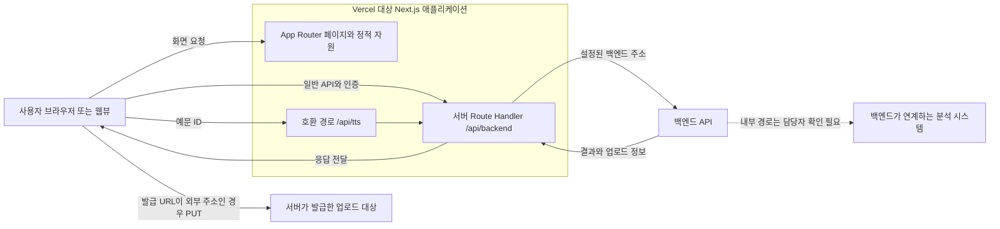

# SpeakAI 프론트엔드 배포 구성 보고서

검토 기준: 2026-11-07 / VC-FE `39d8b16`. 신규 추가안. 권장 삽입 위치: 통합본의 배포·운영 환경 중 프론트엔드 절. 실제 장 번호는 원본 확인 필요이다. 디자인 작업은 범위에 포함하지 않는다.

## 보고서 삽입용 본문

SpeakAI 프론트엔드는 Next.js App Router 애플리케이션으로 구성하였으며, 브라우저 화면과 정적 자원 제공 외에 백엔드 통신을 중계하는 서버 Route Handler를 포함한다. 저장소의 Capacitor 설정 및 네이티브 운영 문서에는 `vc-fe.vercel.app`이 앱 서버 기본 주소로 기재되어 있어 Vercel을 대상으로 하는 운영 구성을 확인하였다. 다만 기본 주소의 존재는 현재 배포의 성공 여부, 최신 소스 반영 여부 또는 연결 프로젝트의 대시보드 설정을 증명하지 않는다.

프로젝트 루트의 `package.json`은 개발 명령으로 `next dev`, 빌드 명령으로 `next build`, 운영 실행 명령으로 `next start`를 정의한다. 프레임워크 버전은 잠금 파일 기준 Next.js 16.3.5이며, `next.config.ts`에는 Turbopack 루트를 현재 작업 디렉터리로 지정하였다. 별도의 정적 export나 사용자 지정 출력 디렉터리 설정은 없다. 로컬 Next.js 기본 빌드 산출 경로는 `.next`이며, 이를 Vercel 대시보드에 입력된 Output Directory 값으로 간주하지 않는다. 또한 `dist`의 정적 파일만 배포하는 Vite SPA 구성으로 설명하지 않는다.

API 통신은 브라우저가 동일 출처의 `/api/backend` 경로를 호출하고 Next.js 프록시가 백엔드로 전달하는 방식이다. 프록시는 서버 주소 설정에 `API_BASE_URL`을 우선 사용하고 `NEXT_PUBLIC_API_BASE_URL`을 대체 이름으로 참조한다. 주소 값과 인증 정보는 보고서에 수록하지 않는다. 브라우저의 예시 사용자 조회 경로는 `/api/backend/api/users/me`이고, 프록시가 전달하는 백엔드 경로는 `/api/users/me`이다. 예문 음성의 이전 호환 경로 `/api/tts?exampleId=...`도 동일 프록시를 통해 백엔드 음성 응답으로 연결한다. 현재 경로에서 프론트엔드가 Google Cloud TTS SDK를 직접 호출한다고 기술하지 않는다.

프록시는 요청 헤더 중 연결·호스트·브라우저 출처 관련 일부 항목을 제거하고 전달 출처 헤더를 추가한다. 응답은 상태 코드와 허용된 헤더를 전달하고 `Cache-Control: no-store`를 설정한다. 백엔드의 Set-Cookie는 Domain을 제거하고 Path를 루트로 조정한다. 브라우저가 프록시를 사용하는 일반 API는 같은 출처 요청이 되지만, 외부 저장소 업로드 URL과 음원 URL 등 직접 통신 경로의 CORS 정책까지 이 구성만으로 해결되는 것은 아니다. 실제 허용 출처·메서드·쿠키 속성은 관련 서비스 설정에서 확인해야 한다.

서버 주소가 없거나 형식이 잘못된 경우, HTTP(S)가 아닌 주소 또는 자기 자신을 가리키는 프록시에는 오류 응답을 제공한다. 상위 서버 요청은 요청 취소 신호와 60초 제한을 결합하여 수행하며, 연결 실패는 503과 `Retry-After: 2`로 변환한다. 이는 코드의 요청 제한 값이며 Vercel 함수의 실제 최대 실행 시간이나 요금제 제한을 나타내지 않는다. 업로드 본문은 현재 프록시에서 `arrayBuffer()`로 읽으므로 실제 전송 크기와 플랫폼 한도에 대한 운영 확인도 필요하다.

배포 이후 점검에서는 배포된 커밋과 프론트엔드 소스의 일치 여부, 직접 URL 접근과 새로고침, 로그인·쿠키 갱신, 파일 업로드, 분석 대기·결과 조회를 구분해야 한다. 이번 보고서 작성에서는 소스·타입·모의 API 계약을 확인하였으며 실제 서비스 배포, 운영 API 요청 및 Vercel 설정 변경은 수행하지 않았다.

## 확인된 구성과 운영 확인 대상

| 항목 | 저장소에서 확인한 사실 | 확인하지 못한 부분 | 근거 |
|---|---|---|---|
| 플랫폼 | Capacitor 서버 기본 주소와 문서에 Vercel 도메인 기재 | 연결된 Vercel 프로젝트와 현재 가용성 | E35 |
| 배포 대상 | 루트에 package.json, next.config.ts, src/app 존재 | Vercel Root Directory 실제 값 | E01, E36 |
| 빌드 | `npm run build` → `next build` | 대시보드의 명령 override, 최신 빌드 로그 | E01, E36 |
| 산출물 | 사용자 지정 distDir·static export 설정 없음. 기본 `.next` 구조 | Vercel 내부 산출물 및 Output Directory 설정값 | E36 |
| 라우팅 | App Router 페이지, 동적 학습·이력 경로, 서버 프록시 | 배포된 각 경로의 접근·새로고침 | E03, E04 |
| 환경 설정 | 소스에서 사용하는 환경변수 **이름** 확인 | 실제 값, Production/Preview 범위, 등록 여부 | E35–E38 |
| 자동 배포 | Git 커밋·PR 병합 이력 존재 | Git 연결·자동 배포·production branch·preview 정책 | 확인 필요 |
| CORS·쿠키 | FE 동일 출처 프록시, credentials 포함, 쿠키 경로 조정 | 백엔드·스토리지 허용 정책과 실제 쿠키 속성 | E05, E37 |
| 실행 제약 | 프록시 내부 60초 timeout, no-store 및 오류 변환 | 플랫폼 함수 시간·본문 크기·지역 설정 | E37 |
| 운영 성공 | 과거 문서에 Vercel 경로 관련 관측 있음 | 현재 서비스와 이번 HEAD 배포 성공 | 확인 필요 |

`vercel.json`, `.vercel/project.json` 또는 배포 자동화 워크플로는 조사 범위에서 발견되지 않았다. 이 파일들이 없다고 Vercel을 사용하지 않는다는 뜻은 아니며, 대시보드 설정을 소스로 확정할 수 없다는 의미이다.

## 배포 단계별 설명

| 단계 | 보고서에 사용할 수 있는 설명 | 상태 |
|---|---|---|
| 소스 관리 | Git 저장소 및 병합 이력으로 프론트엔드 변경을 관리하였다 | Git 확인 |
| 플랫폼 연결 | Vercel 주소를 앱 서버 기본 주소로 지정하였다 | 코드·문서 확인. 실제 Git 연결은 확인 필요 |
| 환경 구성 | 백엔드 주소·사이트 주소·소셜 로그인·네이티브 접속 등의 설정 이름을 구분하였다 | 값과 배포 범위 미확인 |
| 빌드 | `next build`를 실행하도록 정의하였다 | 명령 확인. 이번 빌드 미실행 |
| 배포 | Next.js 페이지·정적 자원·동적 서버 경로가 함께 필요한 구조이다 | 배포 실행 미수행 |
| 접속 확인 | 루트·학습·이력 직접 진입과 API 프록시를 점검해야 한다 | 운영 미검증 |
| 연동 확인 | 인증, 음성 전송, 분석 조회와 완료 흐름을 구분하여 확인해야 한다 | 모의 계약만 실행 확인 |

## 배포 관련 문제 대응 근거

확인된 과거 기록으로는 `docs/analysis-polling-recovery-20261003.md`의 병합 과정에서 발생한 import 누락 및 `docs/qa/mypage-query-contract-20261101.md`의 개발용 생성 파일 손상 기록이 있다. 두 사례를 ‘Vercel에서만 발생한 장애’로 변경하여 서술하지 않는다. 문서가 기록한 과거 빌드 결과와 이번 타입 검사 결과도 구분한다.

현재 코드에는 프록시 주소 누락·오류·자기 참조·타임아웃을 처리하는 분기가 있다. 이는 장애 대응 구현의 근거이며, 각 장애가 실제 운영에서 발생했다는 근거는 아니다. 분석 중 일시적인 GET 오류 복구는 기술 문제 해결 사례로 포함하되, Vercel 자체 장애의 원인으로 단정하지 않는다.

## 배포 구조도

아래 그림은 저장소가 표현하는 배치 구조이다. Vercel 영역은 기본 주소·문서로 확인된 대상이며 현재 배포 완료를 나타내지 않는다. 백엔드와 AI 사이의 내부 구현은 이 저장소에서 검증하지 않았다.

## 배포 증빙 자료

| 자료 | 표시할 내용 | 현재 상태 |
|---|---|---|
| 프로젝트 설정 | Framework Preset, Root Directory, 명령 설정 | 캡처 필요 |
| 배포 상세 | 성공 상태, 배포 시각, 연결 브랜치, 커밋 SHA | 캡처 필요 |
| 실제 서비스 | 로그인 또는 홈 진입, 직접 URL 새로고침 | 캡처·실행 확인 필요 |
| 프록시 요청 | 승인된 시험 계정의 경로·상태·오류 복구 | 실제 통신 확인 필요. 헤더·본문의 인증·개인정보 제외 |

환경변수 값, 서명된 업로드 URL의 쿼리, 쿠키, Access Token 및 개인 계정 정보는 캡처에서 제외한다. 플랫폼 대시보드 화면은 아직 촬영하지 않았다.
