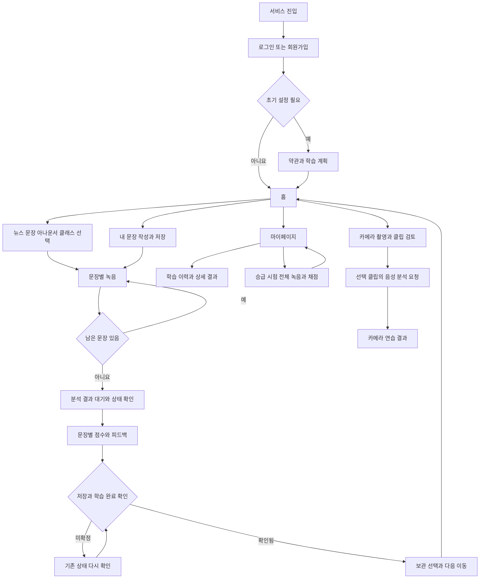
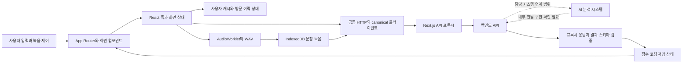
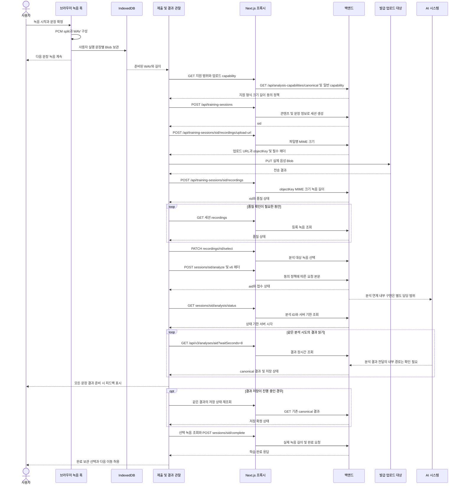

# SpeakAI 프론트엔드 사용자 흐름과 API 처리

기준: 2026-11-07 / `39d8b16`. 실제 App Router와 활성 컴포넌트를 기준으로 정리하였다. 이 문서는 프론트엔드 구현 설명이며 디자인·PPT 제작 자료를 대신 작성한 문서가 아니다. 통합본 삽입 장 번호는 원본 확인 필요이다.

## 화면별 사용자 동작과 상태 변화

API 경로는 백엔드 기준이다. 일반 브라우저 요청에는 `/api/backend`가 앞에 붙는다. ‘다음 상태’가 같은 경로 안의 컴포넌트 전환이면 별도 페이지가 생성된 것으로 표현하지 않았다.

| 단계·경로 | 사용자 동작 | 프론트엔드 처리와 API | 다음 화면·상태 | 오류·예외 |
|---|---|---|---|---|
| 첫 진입 `/` | 로그인 방식 선택 | 기존 인증 상태 확인. 상태 미확정 시 `GET /api/users/me` 사용 | 인증된 경우 `/home`, 그 외 이메일 로그인 또는 소셜 인증 | 이 진입 화면은 사용자 조회 실패 시 로그인 화면을 표시. 보호 경로의 장애 화면과 구분 |
| 이메일 `/login/email` | 이메일·비밀번호 제출 | 입력 확인 → `POST /api/auth/login` → 인증 저장 | 온보딩 완료 여부에 따라 홈 또는 초기 설정 | 중복 제출 차단, 한국어 오류 안내 |
| 가입 `/signup` | 이메일 확인·정보 입력 | `GET /api/auth/email-availability`; 입력 완료 시 같은 페이지의 `TermsScreen` 표시 | 약관 단계 | 오래된 중복 확인 응답 무시 |
| 가입 화면 내부 약관 | 필수 약관 동의 | `POST /api/auth/signup`; 사용자별 약관 선택 상태 기록 | `/onboarding` | 미동의·가입 실패 시 진행하지 않음 |
| 소셜 `/oauth/{provider}/callback` | 제공자 인증 완료 | Google·Kakao·Naver 콜백에서 state·시도 정보 확인 → `POST /api/auth/social-login` | 홈 또는 약관·온보딩 | state 불일치·콜백 만료·제공자 오류 |
| 초기 설정 `/terms`, `/onboarding` | 약관·학습 목적·일정 선택 | 보호 화면 진입 판단; 온보딩 조회·저장 `GET/PUT /api/onboarding/me` | 저장 완료 후 홈 | 필수 입력·저장 실패 처리 |
| 홈 `/home` | 추천·학습 유형 선택 | `/api/home`, 추천·주간 통계·이력·클래스·미읽음 알림을 독립 조회 | 목록 또는 `/practice/{id}` | 영역별 로딩·캐시·오류 표시 |
| 뉴스 `/news` | 주제 선택·항목 선택 | 뉴스 목록 snapshot과 인기 뉴스 API, 화면 분류 적용 | `/practice/{id}?returnTo=...` | 목록 실패·새로고침·빈 목록 |
| 문장 `/sentences` | 분류·난이도·문장 선택 | 콘텐츠 facets와 목록, 페이지·완료 상태 처리 | 상세 또는 바로 연습하는 쿼리 경로 | facets 실패 시 임의 선택지를 성공값으로 사용하지 않음 |
| 아나운서 `/announcer` | 따라 읽을 콘텐츠 선택 | ANNOUNCER 목록·콘텐츠·기준 음성 정보 | `/practice/{id}` 내 연습 | 음원 미제공·재생 실패 안내 |
| 내 문장 `/my-script` | 주제·원고 작성 및 저장 | `GET/POST/PUT /api/users/me/script-library...`, 필요 시 콘텐츠 조회 | 같은 화면의 공통 연습 | 서버 ID 없는 로컬 원고는 AI 제출 제한 |
| 클래스 `/class`, `/class/pronunciation`, `/class/intonation` | 클래스 펼침·단계·예문 선택 | 목록·상세·진도·단계·예문 API. 상세/예문 사전 요청 | `/practice/{id}`와 course·example 관련 쿼리 | 시작 409는 기존 진도 확인, 상세 실패 별도 처리 |
| 새 일반 연습 `/practice/{id}` | 녹음 시작·일시정지·다음 문장 | `PracticeSession` → `SentencePracticeSequence`; 로컬 PCM 분할·WAV 보관 | 다음 문장 녹음 또는 결과 대기 | 마이크 거절·로컬 보관 실패·이탈 확인 |
| 문장별 제출 같은 화면 | 녹음한 문장 확정 | 백그라운드 제출 컴포넌트가 capability → 세션 → 업로드 → 등록·품질·선택 → analyze | 문장별 접수 ID 확보 | 지원 불가, 크기·길이·MIME, 사용량 제한, 전송 실패 |
| 분석 결과 같은 화면 | 대기·재확인·피드백 열기 | status → canonical 결과 장시간 GET; 서버 저장 상태·완료 별도 확인 | 문장별 결과와 완료 선택 | 같은 ID 재조회. 임의 재추론·가짜 성공 처리 없음 |
| 완료 같은 화면 | 보관 여부와 다음 이동 선택 | 로컬 리포트 선택 저장, 클래스 진도·완료 API, 캐시 무효화, 로컬 녹음 정리 | 다음 콘텐츠·홈·클래스 | 저장·완료 미확정이면 이동 버튼 제한 |
| 기존 세션 `?sessionId=...` | 이어보기·재생·분석 요청 | `RecordingPracticeSession`; 세션 상태·선택 녹음·기존 분석 복구 | 녹음 준비 또는 기존 결과 | 이미 접수된 분석은 먼저 조회하여 복구 |
| 승급 `?titleExamId=...` | 응시·녹음·채점 확인 | 시험 생성·조회·복구 → 전체 녹음 분석 → `POST /api/users/me/title-exams/{id}/submit` | 시험 결과·`/mypage` | 상태·점수·칭호 모순 응답 거절 |
| 카메라 `/lip-practice` | 권한 허용·촬영·클립 선택·분석 동의 | 로컬 영상+PCM 음성; 현재 제출은 음성 Blob과 인증형 분석 API | 선택 클립의 분석 결과 | 카메라/마이크 권한, 중복 전송 방지, 서버 지원 확인 |
| 마이 `/mypage` | 통계·피드백·칭호 확인 | 계정·월간/누적 통계·강약점·칭호, `YEAR` 발음 추이 | 이력·계획·설정·결제·시험 | 부분 로딩, 캐시, 응시 불가 안내 |
| 이력 `/mypage/history` | 기간·유형·기록 선택 | 학습 세션 페이지 조회·필터·캐시 | `/mypage/history/{sessionId}` | 빈 목록·조회 실패·추가 로딩 오류 |
| 기록 상세 `/mypage/history/{sessionId}` | 녹음/리포트 보기·삭제 | 이력 상세 → 로컬 보관 선택 → 해당 canonical 결과·콘텐츠; DELETE 시 캐시 정리 | 상세 유지 또는 이력 목록 | 다른 시도·미제공 결과·삭제 실패 구분 |
| 계획 `/mypage/plan` | 학습 계획 변경 | 온보딩 GET/PATCH 또는 null 해제 시 PUT → 저장 값 재조회 | 계획 갱신 | 주간 목표 불일치면 실패 안내 |
| 설정 `/mypage/settings` | 프로필·알림·공지·문의·로그아웃 | 사용자·수신 설정·공지·문의 및 로그아웃 API | 설정 또는 진입 화면 | 변경별 오류·확인 다이얼로그 |
| 결제 `/mypage/payments` | 결제·상태 확인·취소·환불 | 주문 → PortOne → 서버 검증; 주문·환불 상태 재조회 | 최신 결제·회원 상태 | 확인되지 않은 결제를 성공 처리하지 않음 |
| 알림 `/home/notifications` | 알림 열기·읽음 처리 | 알림 목록, 개별/전체 읽음 API | 해당 항목 또는 알림 목록 | 빈 상태와 요청 실패 구분 |
| 연속 학습 `/home/streak` | 월별 완료일 확인 | 기간별 통계·학습 이력 조회, 날짜 집계 | 같은 화면 | 실제 응답 범위·날짜 기준 확인 필요 |
| 관리자 `/admin/[[...segments]]` | 권한 있는 운영 작업 | `/api/admin/me`로 권한 확인 후 기능별 관리 API | 관리자 하위 화면 | 401/403 시 접근 제한·캐시 제거, 충돌 시 재조회 |

구현 근거: E02–E34. Apple 관련 설정·타입이 있다는 이유만으로 전용 Apple 콜백 페이지가 구현되었다고 단정하지 않는다. `/terms/complete`는 라우트가 존재하지만 현재 회원가입의 약관 처리 후 기본 이동은 `/onboarding`이다.

## 사용자 관점의 흐름도

녹음 중의 업로드·분석 작업은 사용자가 매번 다른 화면으로 이동하는 단계가 아니므로 사용자 도식에서는 숨기고 아래 기술 시퀀스에서 구체화하였다.

## 기술 구조도

일반 학습의 활성 경로는 인증형 백엔드 API를 사용한다. 남아 있는 Direct·batch 모듈은 이 dispatcher의 일반 신규 연습 경로와 구분한다. 저장 화면의 과거 Direct 이력 접근은 별도 잔존 경로이다.

## 문장 녹음 및 분석 API 시퀀스

대표 흐름은 새 일반 연습의 **문장 한 개**이다. 다음 문장의 로컬 캡처는 아래 서버 처리와 독립적으로 진행된다. `sid`, `rid`, `aid`는 설명용 식별자이며 실제 개인정보·토큰이 아니다.

시퀀스의 `sessions`는 도식 폭을 위한 약칭이며 실제 경로는 `/api/training-sessions`이다. 업로드 URL이 프록시 주소이면 PUT도 Next.js를 경유하고, 외부 주소이면 브라우저가 해당 대상으로 직접 전송한다. AI 시스템 화살표는 백엔드가 제공하는 분석 계약의 책임 경계만 표현하며, 직접 확인하지 않은 큐·DB·모델 실행 순서를 확정하지 않는다. API의 상세 경로와 구조는 05 FE-D에 수록하였다.

## 주요 예외와 복귀 동작

| 상황 | 실제 처리 또는 제한 |
|---|---|
| 마이크 권한 거절 | denied/error 상태와 권한 안내. 정상 녹음으로 표시하지 않음 |
| IndexedDB 저장 실패 | 원본 Blob을 메모리에 유지하고 재보관을 제공. 브라우저 종료 후 복구는 보장 불가 |
| 업로드 승인 401·403 | 지정 업로드 승인 오류에 한해 URL 재발급 후 1회 재전송 |
| analyze 응답 유실 | 같은 세션·분석 상태 확인 우선. 자동 신규 분석 반복 없음 |
| 일시적 결과 조회 오류 | 재시도 가능한 네트워크·상위 오류에 같은 ID로 제한된 재조회 |
| 새 계정 로그인·화면 종료 | 세션 세대·AbortController·active 표식으로 오래된 응답 차단 |
| 피드백 도착 후 저장 지연 | 피드백 유지, 저장 확인 메시지와 재조회. 완료·진도 확정은 보류 |
| 목록 복귀 | 사용자 캐시와 history entry별 필터·스크롤 복원. 새 방문과 구분 |
| 이미 존재하는 분석 재진입 | 등록·선택 녹음과 같은 분석 ID를 확인하여 복구 |
| 시험 불합격 | 서버의 FAILED와 점수·칭호 일관성 확인. 클라이언트에서 승급하지 않음 |

## 직접 경로와 내부 화면의 구분

`/practice/custom`는 `/my-script`, `/news/today`는 `/news`, `/home/history`는 `/mypage/history`, `/auth`는 `/`로 이동하는 호환 경로이다. 아나운서의 과거 morning-news 경로도 `/announcer`로 이동한다. 상세 패널·리포트 오버레이·회원가입 내부 약관은 각각의 실제 코드가 정한 화면 상태로 기술한다.

`/preview/*`는 개발 환경 조건이 있는 미리보기이며, 해당 화면의 예시 점수·가상 데이터는 운영 구현 결과의 증빙으로 사용하지 않는다. 실제 캡처 대상은 [07 캡처자료 목록](07_캡처자료_목록.md)을 따른다.
