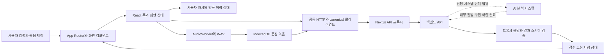
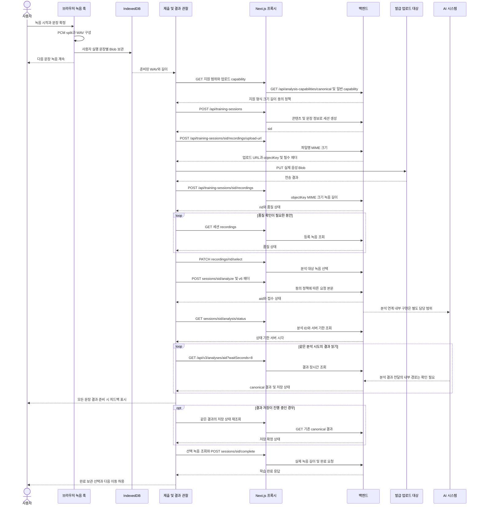
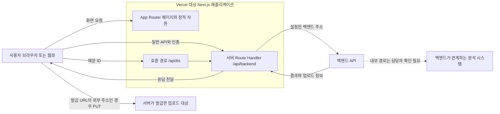
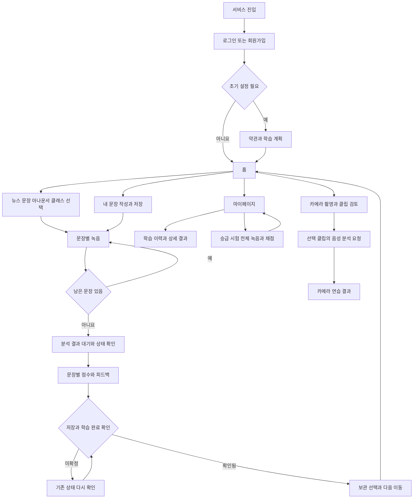

# SpeakAI 프론트엔드 구현 통합보고서

기준일: 2026-11-07 · 대상 저장소: VC-FE · 기준 커밋: `39d8b169f02387c6c8f120777520a5017c44e44b`.

프론트엔드 구현, API 연동, 음성 녹음과 분석 결과 처리, 상태·캐시 관리, 기술적 문제 해결, Vercel 배포 구성 및 검증 내용을 하나의 문서로 통합하였다. 디자인 제작과 PPT 작업은 담당 범위에서 제외하였다. 본문과 상세 부록을 함께 수록하여 이 파일만으로 구현 내용과 검증 한계를 확인할 수 있도록 구성하였다.

팀 통합 최종보고서 원본은 발견되지 않았다. 아래 1~8절과 부록 A~E는 이 프론트엔드 문서의 내부 번호이며, 팀 보고서의 실제 장 번호를 확정하거나 기존 1장을 수정한 것이 아니다. 본문·부록은 신규 추가안으로 작성하였고, 기존 문서의 정정 제안은 부록 E에 구분하였다.

검증 요약: 기존 테스트 **388개 중 375개 통과·13개 실패**, 모의 API 계약 **90/90 및 토큰 갱신 재시도 통과**, **TypeScript 검사 통과**. 운영 API·DB·실제 배포·실결제 요청은 수행하지 않았다. 빌드·lint·브라우저 E2E는 미실행이며, 기존 소스와 설정은 변경하지 않았다.

## 목차

- [1. 개발 환경 및 시스템 구성](#architecture)
- [2. 주요 기능 구현](#features)
- [3. API 연동 및 상태 관리](#integration)
- [4. 성능 및 안정성 개선](#improvements)
- [5. Vercel 배포 구성](#deployment)
- [6. 사용자 흐름](#flow)
- [7. 테스트 및 검증 결과](#verification)
- [8. 구현 결과와 후속 과제](#followup)
- [부록 A. 기술 스택과 디렉터리](#stack)
- [부록 B. API 연동 명세](#api)
- [부록 C. 기술근거 매핑표](#evidence)
- [부록 D. 캡처자료 계획](#captures)
- [부록 E. 기존 문서 검토와 취합 기준](#review)

<a id="architecture"></a>

## 1. 개발 환경 및 시스템 구성

SpeakAI 프론트엔드는 사용자가 학습 콘텐츠를 선택하고 음성을 녹음한 뒤 분석 결과와 학습 이력을 확인하는 웹 애플리케이션으로 구현하였다. 프론트엔드 담당 범위는 페이지와 재사용 컴포넌트 구현, 사용자 입력 및 브라우저 미디어 처리, 백엔드 API 연동, 상태·캐시 관리, 결과 표시 및 배포를 위한 웹 애플리케이션 구성이다. AI 점수 산출, 음소 분석, 코칭 문장 생성 및 데이터베이스 처리는 연동 대상 시스템의 책임으로 구분하였다.

프레임워크는 Next.js 16.3.5, 화면 라이브러리는 React와 React DOM 19.2.8, 개발 언어는 TypeScript 5.9.3을 사용하였다. 이 버전은 의존성 잠금 파일의 해석 결과이며 `package.json`의 버전 범위와 구분하였다. 빌드 명령은 `next build`이고, Next.js 설정에는 Turbopack의 프로젝트 루트를 지정하였다. 라우팅은 `src/app`의 App Router 파일 구조와 `next/navigation`을 사용한다. `src/routes`에 화면 구현이 있으나 별도의 라우터 라이브러리가 경로를 등록하는 구조는 아니다.

화면 구현은 Tailwind CSS 4.3.3, 전역 스타일, 컴포넌트별 CSS Modules 및 Radix UI 기반 공통 제어 요소를 함께 사용하였다. 컴포넌트의 상태는 React 훅으로 관리하고, 인증 상태와 사용자별 영속 캐시는 별도 모듈로 구성하였다. TanStack Query 5.101.4는 코칭 사용량과 관리자 조회에 사용하며, 일반 사용자 화면 전체가 동일한 Query 캐시로 관리되는 것은 아니다. API 데이터의 런타임 검증이 필요한 분석 결과·지원 범위·관리자 입력에는 Zod를 적용하였다.

`src/app`은 URL 진입점, 레이아웃 및 서버 Route Handler를 정의한다. `src/routes`는 홈, 학습, 마이페이지와 카메라 연습 등 화면을 구성한다. `src/components`는 목록, 녹음 세션, 분석 결과, 재생기, 공통 내비게이션과 입력 요소를 제공한다. `src/hooks`는 녹음, 이탈 확인, 목록 상태 복원 등의 수명 주기 처리를 담당한다. `src/lib/api`는 HTTP 통신과 요청·응답 타입을 정의하고, `src/lib`에는 캐시·분석 대기·결과 검증·학습 완료 등 기능별 처리 로직을 배치하였다. 관리자 기능은 `src/features/admin`에 별도로 구성하였다. 다만 여러 화면 컴포넌트에서 API 요청과 상태 갱신을 직접 수행하므로, 모든 화면이 엄격한 서비스 계층으로 완전히 분리되었다고 기술하지 않는다.

### 시스템 데이터 흐름



일반 학습의 활성 경로는 인증형 백엔드 API를 사용한다. 남아 있는 Direct·batch 모듈은 이 dispatcher의 일반 신규 연습 경로와 구분한다. 저장 화면의 과거 Direct 이력 접근은 별도 잔존 경로이다.

기술별 적용 목적과 잠금 버전, 주요 디렉터리는 [부록 A](#stack)에 정리하였다.

<a id="features"></a>

## 2. 주요 기능 구현

### 사용자 인증과 초기 설정

이메일 회원가입·로그인과 소셜 로그인 콜백을 구현하였다. 회원가입 화면은 이메일 형식과 중복 여부, 비밀번호 조건, 비밀번호 일치 여부와 닉네임을 확인한다. 이메일 중복 조회에는 요청 순번을 부여하여 이전 입력에 대한 늦은 응답이 현재 입력 상태를 덮어쓰지 않도록 하였다. 입력을 마치면 같은 회원가입 화면에서 약관 동의 단계로 전환하며, 필수 동의를 확인한 뒤 회원가입 API를 호출한다. 로그인 이후에는 계정의 온보딩 완료 여부와 로컬 약관 상태에 따라 홈, 약관 또는 온보딩 화면으로 이동한다.

공통 HTTP 클라이언트는 Access Token을 메모리와 localStorage에 보관하고 보호된 요청에 Bearer 인증 헤더를 포함한다. JWT의 만료 정보는 갱신 시점을 판단하는 데 사용하며, 실제 인증 판단은 서버가 수행한다. 만료가 임박한 토큰은 요청 전에 갱신하고, 401 응답 시에는 갱신된 토큰으로 원래 요청을 한 번 재시도하도록 제한하였다. 갱신에 사용되는 쿠키를 포함할 수 있도록 요청에 `credentials: include`를 지정하였다. Refresh Token의 실제 쿠키 속성 및 만료 정책은 백엔드와 배포 환경에서 확인해야 한다.

보호된 화면 진입은 `SessionGate`가 제어한다. 초기 상태에서는 사용자 정보를 조회하고, 인증 실패는 진입 화면으로, 연결 장애는 재시도 가능한 오류 화면으로 처리한다. 이는 프론트엔드의 화면 진입 제어이며, 서버 API의 접근 권한 검증을 대신하지 않는다. 로그아웃 시에는 서버 로그아웃 요청 결과와 별개로 동일 세션의 로컬 인증 상태를 정리하고 사용자 캐시를 제거한다. 관리자 경로는 별도의 관리자 권한 조회와 응답 검증을 수행한다.

온보딩에서는 학습 목적과 계획을 저장하고, 이후 마이페이지에서 계획을 수정할 수 있도록 연결하였다. 주간 목표를 선택하지 않는 경우에는 null을 변경 없음으로 해석하는 PATCH에 의존하지 않고 PUT으로 전체 답변을 저장한 뒤 재조회하여 실제 저장 값을 확인한다.

### 홈과 학습 콘텐츠 탐색

홈은 학습 현황, 주간 통계, 완료 이력, 진행 중 클래스, 추천 콘텐츠와 알림 상태를 각각 조회한다. 응답을 한 묶음으로 기다리지 않고 준비된 영역부터 갱신하며, 일부 데이터의 실패가 다른 영역의 표시를 막지 않도록 분리하였다. 개인화 추천 조회가 실패하는 경우에는 실제 뉴스 목록을 읽어 일반 학습 항목으로 제시한다. 이 대체 목록은 프론트엔드에서 새로운 AI 추천을 계산한 결과가 아니다.

뉴스 읽기, 문장 연습, 아나운서 따라 읽기는 공통 콘텐츠 목록과 학습 진입 경로를 사용한다. 콘텐츠의 분류·난이도와 페이지 정보를 상태로 관리하며, 추가 조회 결과는 ID를 기준으로 병합한다. 뉴스 목록은 페이지 단위로 읽은 목록을 재사용하여 화면의 분류 조건을 적용하고, 문장 분류는 서버에서 받은 선택지와 값을 사용한다. 일반 사용자 콘텐츠 전반에 자유어 검색이 구현되었다고 확대하여 기술하지 않는다.

클래스는 발음·억양 경로별 목록, 상세 정보, 단계와 예문을 연결하였다. 항목에 포인터를 올리거나 키보드 포커스를 두는 시점에 상세·예문을 사전 요청할 수 있도록 하였다. 학습 시작 시에는 등록·진도 확인과 예문 조회를 병렬로 수행하고, 시작 요청의 충돌은 기존 진도를 확인하여 처리한다. 예문 ID와 개정 정보를 사용하는 학습 진입은 일반 콘텐츠 진입과 구분한다. 학습 완료 뒤에는 실제 완료 결과를 확인한 후 클래스 진도를 갱신한다.

내 문장 기능은 원고 보관함의 목록·주제 생성·원고 저장 및 삭제를 API와 연결하였다. 사용자가 작성한 원고는 서버 콘텐츠 ID가 확보된 후 공통 연습 흐름으로 전달한다. 로컬 전용 콘텐츠에는 서버 ID가 없을 수 있으므로, 로컬 녹음 가능 여부와 AI 분석 요청 가능 여부를 분리하였다.

### 음성 녹음과 문장별 분석 연동

일반적인 새 연습은 `PracticeSession`에서 `SentencePracticeSequence`로 연결된다. 뉴스·문장·아나운서·내 문장과 클래스 예문을 문장 목록으로 변환하고, 동일한 마이크 스트림에서 각 문장의 PCM 샘플을 분할한다. Web Audio의 AudioWorklet을 사용하여 음성 샘플을 수집하고 16비트 모노 WAV로 구성하였다. 녹음 시작 알림음은 샘플 수집 전에 재생하여 녹음 데이터에 포함되지 않도록 하였다.

일시정지는 마이크 스트림을 종료하지 않고 샘플 수집을 멈추며, 재개 시 같은 흐름을 이어간다. 일시정지 시간은 문장별 녹음 경과 시간에서 제외한다. 문장을 확정하면 해당 WAV를 저장하고 다음 문장의 녹음을 진행한다. 이 전환은 서버 업로드나 추론 완료를 기다리지 않는다. 확정한 파일은 사용자·연습·실행 ID·문장 위치를 구분하여 IndexedDB에 보관하며, 접수된 세션·녹음·분석 식별자는 별도 사용자 캐시에 기록한다. 따라서 로컬 파일의 복구와 서버 분석 상태의 복구를 분리하였다.

문장 파일이 준비되면 공통 제출 로직이 분석 지원 범위, MIME 형식, 파일 크기, 녹음 길이 및 동의 정책을 확인한다. 이후 학습 세션 생성, 업로드 주소 발급, 파일 PUT 전송, 녹음 등록, 음질 확인, 녹음 선택, 분석 요청 순서로 API를 호출한다. 업로드 진행률과 분석 대기 상태를 별도로 관리하고, 파일 전송과 등록이 끝나기 전에 결과를 표시하지 않는다. 업로드 주소가 인증 거절로 만료된 경우에는 주소를 다시 발급받아 한 번 재전송한다.

현재 분석 요청은 v6 결과 스키마 헤더를 사용한다. 결과 조회는 상태 API에서 분석 식별자와 서버 제한 시간을 확인한 뒤 canonical 결과 API를 기다리는 방식으로 구현하였다. 장시간 GET의 `waitSeconds=8`을 사용하며, 연결 장애가 발생하면 같은 분석 시도를 재조회한다. 응답 확인에 실패했다고 자동으로 새로운 분석 POST를 반복하지 않는다. 재시도는 서버가 제공한 실패 상태와 재시도 가능 조건을 확인하여 수행한다.

분석 피드백 도착과 학습 이력 저장·완료는 서로 다른 상태로 관리한다. 서버가 반환한 유효한 피드백은 결과 화면에서 확인할 수 있지만, 저장 상태가 미확정이면 완료 버튼과 클래스 진도 갱신을 보류한다. 사용자는 이미 받은 결과를 유지한 채 저장 상태를 다시 조회할 수 있다. 브라우저 이탈과 계정 전환 시에는 로컬 관찰 요청을 중단하고 늦게 도착한 응답을 현재 화면에 반영하지 않도록 하였다.

### 기존 세션 복구와 승급 시험

URL에 기존 `sessionId`가 있으면 해당 세션을 복원하는 경로를 사용한다. 승급 시험은 `titleExamId`를 기준으로 별도 시험 컴포넌트가 세션 생성·복구와 채점 요청을 맡고, 공통 녹음 컴포넌트를 재사용한다. 기존 세션 및 시험처럼 전체 녹음 하나가 필요한 경로는 문장별 PCM을 결합하여 전체 WAV를 구성한다. 일반 문장별 점수를 프론트엔드에서 합산하여 시험 결과를 만들지 않는다.

승급 시험 결과는 서버의 상태, 합격 여부, 점수와 기준 점수, 이전·현재 칭호가 일관되는지 확인한 뒤 표시한다. 서로 모순되는 응답은 승급 성공으로 표시하지 않고 재확인을 안내한다. 합격·불합격의 최종 판단과 칭호 변경은 서버가 수행하며, 프론트엔드는 검증된 응답을 표시하고 관련 캐시를 갱신한다.

### 카메라 연습

카메라 연습은 카메라·마이크 권한 요청, 얼굴 위치 안내, 촬영, 클립 선택과 로컬 재생을 구현하였다. 현재 제출 코드에서는 촬영 클립에 대응하는 **음성 Blob**을 준비하고, 음성 분석 지원 범위를 확인한 뒤 학습 세션으로 업로드한다. 분석 호출 함수의 이름이 `analyzeAudiovisual`이더라도 실제 제출 대상은 해당 경로에서 준비한 음성이다. 따라서 이 구현만으로 영상 파일이 서버에 전송되거나 입술 영상 모델의 분석이 운영에서 성공한다고 결론 내릴 수 없다.

서버 응답에 영상 보조 정보가 포함되면 카메라 연습 문맥에서만 관련 정보를 표시하도록 구성하였다. 일반 음성 연습에는 영상 피드백을 노출하지 않는다. 영상 점수가 없는 경우에는 미제공으로 표시하며, 영상 관련 점수를 음성 종합 점수에 합산하지 않는다. 실제 영상 입력 계약과 운영 제공 범위는 별도 검증 과제로 남긴다.

### 분석 결과와 학습 이력

분석 결과 화면은 서버에서 전달한 유효한 종합 점수, 제공 가능한 세부 항목, 코칭 설명과 연습 행동을 표시한다. canonical 결과를 Zod 스키마와 분석·녹음·요청·실행 식별자로 검증하여 다른 시도의 결과가 섞이지 않도록 하였다. 종합 점수는 AI가 반환한 값을 사용하며, 세부 점수가 누락되었다는 이유로 임의 점수를 계산하지 않는다. 현재 일반 canonical 변환에서 발음 별도 점수, 억양·속도·강세·휴지 값은 null로 유지한다.

피드백은 서버가 공개를 허용하고 코칭 데이터가 준비된 경우에 표시한다. 교정 후보의 관측 발음과 기대 발음을 비교하고, 서버가 제공한 단어 시간 구간이 유효하면 해당 녹음 구간을 재생한다. 해당 후보의 정답 음성 재생에는 제공 가능한 음원 계약이 필요하므로 모든 후보에 자동 TTS가 제공된다고 기술하지 않는다. 현재 활성 문장별 흐름은 문장별 분석 세션으로 결과를 구분하며, 과거 세그먼트 API가 모든 단어 판정을 제공하는 구조로 설명하지 않는다.

마이페이지에서는 월간 통계, 가입일 이후 누적 통계, 강점·약점 및 칭호를 구분하여 조회한다. 성장 그래프는 최근 1년의 발음 점수 추이를 받아 주간·월간 등의 묶음으로 표시하며, 현재 화면은 HTML 버튼과 CSS 막대 높이로 구현하였다. 의존성에 Recharts가 존재하지만 현재 성장 그래프가 Recharts 기반이라는 설명은 사용하지 않는다. 학습 이력 상세에서는 해당 세션과 녹음에 연결된 canonical 결과를 다시 조회한다.

리포트 저장 여부는 사용자별 localStorage의 보관 선택값이다. 이는 서버의 분석 저장이나 학습 완료와 다른 기능이며, 기기 간 동기화를 보장하지 않는다. 서버 이력 삭제는 별도 API로 수행한다. 이 구분을 통해 ‘리포트 보관’과 ‘학습 데이터 저장’을 같은 동작으로 오해하지 않도록 하였다.

### 부가 기능과 공통 사용성

알림 목록·읽음 처리, 수신 설정, 프로필, 공지·문의 및 결제 이력을 연결하였다. 결제 화면은 주문 생성, PortOne 결제창 호출, 서버 결제 검증과 취소·환불 요청을 단계별로 처리한다. 이 보고서에서는 결제 시스템의 정산·운영 적합성을 프론트엔드 성과로 포함하지 않는다. 관리자 화면은 회원, 콘텐츠, 기준 음성, 공지, 문의, 알림 캠페인, 팝업 및 감사 기록의 조회·관리 UI를 별도 권한 경로로 구성하였다.

공통 화면에는 뷰포트 높이, safe-area, 스크롤 영역과 화면 폭 제약을 적용하였다. 입력 요소의 레이블, 오류 알림 역할, 로딩 상태 안내, 포커스 표시와 모션 감소 설정을 코드에서 확인하였다. 다만 이를 모든 기기의 반응형 검증이나 웹 접근성 기준 충족으로 확대하지 않는다. 키보드 이동, 스크린리더, 실기기 권한 및 화면 확대는 별도 수동 확인이 필요하다.

<a id="integration"></a>

## 3. API 연동 및 상태 관리

브라우저의 공통 API 호출은 `/api/backend`를 기본 경로로 사용한다. 예를 들어 사용자 조회는 브라우저에서 `/api/backend/api/users/me`로 전달되고, Next.js Route Handler가 설정된 백엔드 주소의 `/api/users/me`로 중계한다. 요청·응답의 전달 대상 헤더를 제한하고, 쿠키의 Domain 속성을 제거하며 Path를 루트로 조정하여 같은 웹 출처에서 세션을 사용할 수 있도록 하였다. 프록시와 분석 결과 조회는 `no-store` 정책을 사용한다. 프록시는 일반 요청을 중계하는 코드이며 데이터베이스나 AI 내부 로직을 구현한 것으로 보지 않는다.

HTTP 클라이언트는 공통 응답 봉투의 성공 여부와 데이터를 해석하고, HTTP 상태·오류 코드·재시도 대기 정보를 `ApiError`로 전달한다. 일반 JSON 요청, 바이너리 예문 음성, 파일 업로드의 처리 경로를 구분하였다. 예문 재생은 서버에 등록된 예문 ID를 사용하고, 음성 MIME·빈 응답·크기 제한을 검사한다. 외부 업로드 URL에는 사용자 로그인 토큰을 무조건 첨부하지 않고, 백엔드 프록시 범위에 해당하는 경우에만 인증 헤더를 사용한다.

캐시는 세 종류로 구분하였다. 첫째, 사용자별 localStorage 캐시는 화면의 이전 응답을 즉시 표시하고 재조회 결과로 갱신한다. 둘째, 동일 HTTP 클라이언트의 진행 중 GET 요청은 세션 세대와 요청 경로가 같을 때 Promise를 공유한다. 이 공유는 완료 응답을 저장하는 캐시가 아니며 명시적 signal·headers·timeout·cache 옵션이 있으면 적용하지 않는다. 셋째, 코칭 사용량과 관리자 조회는 TanStack Query의 조회 키와 무효화 정책을 사용한다.

사용자 캐시는 계정 ID와 리소스 이름을 키에 포함하고 저장 시각·버전을 검사한다. 기본 유효 기간은 7일이며, 클래스 상세·예문과 지원 정보 등에는 30분 정책을 명시적으로 적용한 경로가 있다. 화면 진입 후에는 서버를 다시 조회하므로 유효 기간이 곧 네트워크 요청 생략 기간을 의미하지 않는다. 학습 완료 후에는 홈·이력·연속 학습·클래스 목록·마이 요약 캐시를 무효화한다. 관리자 캐시는 세션 변경이나 권한 거절 시 제거한다.

| 주요 단계 | 대표 API | 화면 처리 |
|---|---|---|
| 로그인·세션 확인 | `POST /api/auth/login`, `GET /api/users/me` | 토큰 저장, 상태 확정, 초기 설정 여부에 따라 이동 |
| 콘텐츠·클래스 탐색 | `GET /api/practice-contents`, `GET /api/courses` | 필터·페이지·부분 로딩·캐시 갱신 |
| 녹음 전송 | 세션 생성 → 업로드 URL → PUT → 녹음 등록·선택 | 길이·형식·크기 확인, 진행률, 품질 검사 |
| 분석·결과 | `POST .../analyze`, `GET .../analysis/status`, `GET /api/v3/analyses/{id}` | 같은 분석 시도 대기, 응답 검증, 피드백·저장 상태 구분 |
| 학습 완료·이력 | `POST .../complete`, `GET /api/users/me/training-sessions` | 실제 녹음 길이 전달, 캐시 무효화, 이력 재조회 |

### 문장 녹음 및 분석 API 시퀀스

대표 흐름은 새 일반 연습의 **문장 한 개**이다. 다음 문장의 로컬 캡처는 아래 서버 처리와 독립적으로 진행된다. `sid`, `rid`, `aid`는 설명용 식별자이며 실제 개인정보·토큰이 아니다.



시퀀스의 `sessions`는 도식 폭을 위한 약칭이며 실제 경로는 `/api/training-sessions`이다. 업로드 URL이 프록시 주소이면 PUT도 Next.js를 경유하고, 외부 주소이면 브라우저가 해당 대상으로 직접 전송한다. AI 시스템 화살표는 백엔드가 제공하는 분석 계약의 책임 경계만 표현하며, 직접 확인하지 않은 큐·DB·모델 실행 순서를 확정하지 않는다. API의 상세 경로와 구조는 부록 B에 수록하였다.

<a id="improvements"></a>

## 4. 성능 및 안정성 개선

### 준비된 데이터부터 표시하도록 로딩 분리

**기존 문제:** 과거 홈은 여러 데이터와 이미지의 준비 상태를 함께 확인하여 전체 로딩 화면을 유지하는 분기가 있었다. **원인:** 통계·클래스·추천처럼 독립적인 요청이 함께 완료되어야 상태를 반영하는 구조였다. **개선 방법:** 화면 영역별 요청 완료와 로딩 상태를 분리하였다. **구현 방식:** 통계, 학습 이력, 클래스와 추천을 각각 처리하고 준비된 응답부터 사용자 캐시에 반영하며, 홈의 전체 차단 조건과 이미지 대기를 제거하였다. 마이페이지도 계정·칭호와 통계·피드백의 갱신을 구분하였다. **결과와 검증:** `6a0a766`의 전후 diff와 현재 코드에서 독립 갱신을 확인하였다. 한 영역의 지연이 다른 영역의 상태 갱신을 기다리게 하던 의존성을 줄였으나, 실제 첫 표시 시간의 단축 수치는 측정하지 않았다.

### 중복 조회와 토큰 갱신 경합 처리

**기존 문제:** 같은 화면 데이터가 여러 컴포넌트에서 요청될 때 공통 요청 함수가 개별 네트워크 요청을 생성할 수 있었고, 인증 클라이언트별 갱신 상태만으로는 다른 클라이언트·탭의 동시 갱신을 조정할 수 없었다. **원인:** 요청 공유와 갱신 조정의 범위가 호출자 또는 개별 클라이언트에 한정되었다. **개선 방법:** 동일 GET의 진행 중 Promise와 로그인 갱신 작업을 각각 적절한 범위에서 공유하였다. **구현 방식:** GET은 클라이언트 내부의 `pendingReads`에 세션·경로별로 보관하고 완료 시 제거한다. 인증 갱신은 기본 URL별 공통 Map과 세션 버전을 사용하며, 지원되는 브라우저에서는 Web Locks로 탭 간 순서를 조정한다. 이미 다른 요청이 갱신한 토큰이 있으면 다시 갱신하지 않고 재사용한다. **결과와 검증:** `3a992f4`, `f8c9534`의 diff와 GET 공유·인증 갱신 테스트에서 확인하였다. 모든 GET과 모든 브라우저 환경이 동일하게 공유된다고 주장하지 않으며, 실제 서버 요청 감소율은 미측정이다.

### 클래스 재진입과 목록 상태 유지

**기존 문제:** 목록 재방문 및 클래스 펼침에서 이전 응답을 표시하지 못하면 사용자가 같은 자료를 다시 기다리게 되는 경로가 있었다. **원인:** 목록, 상세, 예문 및 이동 상태의 수명이 서로 달랐다. **개선 방법:** 사용자별 목록·상세 캐시, 상세·예문 사전 요청과 방문 이력별 상태를 조합하였다. **구현 방식:** 클래스 상세와 예문은 공통 요청 객체로 진행 중 작업을 공유하고, 목록에는 페이지와 진행률을 보관한다. 필터와 스크롤은 브라우저 history entry ID를 포함한 키로 보관하여 뒤로 가기 복귀와 신규 방문을 구분한다. 추가 페이지의 늦은 응답은 generation 값이 바뀌면 반영하지 않는다. **결과와 검증:** 관련 로딩·페이지·탐색 테스트가 통과하였다. 스크롤 복원은 메모리 기반이므로 브라우저 전체 종료 뒤의 복구를 보장하지 않는다. 상세 동작의 실브라우저 검증은 별도로 필요하다.

### 업로드 승인 만료와 통계 요청 오류 수정

**기존 문제:** 업로드 주소의 승인 만료와 백엔드 범위에 맞지 않는 주소 처리로 전송이 실패할 수 있었으며, 마이페이지에서는 지원하지 않는 `period=ALL` 요청이 기록되어 있었다. **원인:** 로그인 인증과 저장소 업로드 승인을 같은 문제로 취급하거나, 화면의 ‘전체’ 의미를 API의 기간 열거값과 동일하게 해석한 데 있었다. **개선 방법:** 업로드 주소와 인증 첨부 범위를 구분하고 만료 거절만 한 번 복구하며, 누적 통계와 성장 그래프의 기간 계약을 분리하였다. **구현 방식:** 업로드 401·403 중 지정 오류에 대해서만 URL을 재발급한다. 누적 통계는 가입일의 서울 날짜를 `from`으로, 성장 그래프는 `YEAR`를 사용한다. **결과와 검증:** `a67fd89`, `872b807`의 diff, 관련 문서 및 업로드·마이페이지 쿼리 테스트에서 확인하였다. 저장소 권한 자체의 구성이나 운영 오류 재현은 이번 검증에 포함하지 않았다.

### 결과 수신과 학습 완료의 일관성 확보

**기존 문제:** 분석 응답의 지연·유실, 저장 지연 및 채점 필드의 모순을 곧바로 분석 실패나 승급 성공으로 처리하면 실제 서버 상태와 화면 표시가 어긋날 수 있다. **원인:** 분석 실행, 결과 공개, 저장, 학습 완료와 시험 채점을 하나의 성공 상태로 간주하는 데 있다. **개선 방법:** 각 상태를 분리하고 같은 분석 식별자와 실행 식별자를 확인하였다. **구현 방식:** 결과 대기에는 서버의 제한 시간과 취소 신호를 적용하고, 저장 상태는 별도 읽기 전용 재조회로 확인한다. 완료 요청에는 선택된 녹음의 실제 길이를 사용한다. 시험 결과는 상태·점수 기준·칭호 변경의 일치 여부를 검사한다. **결과와 검증:** canonical 완료·폴링·시험 테스트와 `2257fab` diff에서 확인하였다. 실제 AI 품질이나 서버 저장 성공률의 개선을 의미하지 않는다.

### 변경 이력과 검증 근거

아래 변경은 로컬 Git 객체의 전후 diff로 확인하였다. 커밋의 존재는 실서비스 장애 발생률·성능 수치 또는 특정 개인의 단독 기여를 입증하지 않는다. [E39]

| 변경 근거 | 문제·원인 | 최종 구현·기술적 의미 | 확인 결과 |
|---|---|---|---|
| `6a0a766` | 독립 요청·이미지 준비를 기다리는 전체 로딩 의존 | 홈·마이 영역별 응답 반영, 캐시 초기 표시 | 전후 diff·현재 호출 구조 확인. 표시 시간 미측정 |
| `3a992f4` | 같은 GET에 개별 요청 생성 | 동일 클라이언트·세션·경로의 진행 중 Promise 공유 | `http-read-sharing` 테스트 통과. 완료 응답 캐시와 구분 |
| `f8c9534` | 클라이언트·탭 간 토큰 갱신 경합 | 공통 갱신 Map·Web Locks·다른 요청이 저장한 토큰 재사용 | 인증 갱신·조정 모의 테스트 통과. 실브라우저 다중 탭 미검증 |
| `a67fd89` | 업로드 URL 인증 범위·만료 거절 처리 | 외부 저장소와 로그인 인증 분리, 지정 거절에 1회 재발급 | 업로드 모의 테스트 통과. 운영 스토리지 미검증 |
| `872b807` | 기간 API에 없는 `ALL` 사용 | 가입일 `from`과 `YEAR` 추이로 의미 구분 | 마이 쿼리·점수 집계 검사 통과 |
| `2257fab` | 시험 상태·점수·칭호의 모순 가능성 | 채점 결과 검증 후 합격/실패 표시 | 시험 API 검사 통과. 실제 채점 미검증 |
| `e120716` | 선택적인 세부 기준을 종합 점수 표시의 필수조건으로 취급 | 유효한 AI 종합 점수를 독립적으로 표시 | 점수 관련 테스트 통과. FE 재계산 아님 |

로컬 Git에 보관된 PR 병합 이력은 참고할 수 있으나 외부 PR 리뷰·운영 검수 결과는 별도로 조회하지 않았다. 정량 개선값은 수록하지 않았다.

<a id="deployment"></a>

## 5. Vercel 배포 구성

SpeakAI 프론트엔드는 Next.js App Router 애플리케이션으로 구성하였으며, 브라우저 화면과 정적 자원 제공 외에 백엔드 통신을 중계하는 서버 Route Handler를 포함한다. 저장소의 Capacitor 설정 및 네이티브 운영 문서에는 `vc-fe.vercel.app`이 앱 서버 기본 주소로 기재되어 있어 Vercel을 대상으로 하는 운영 구성을 확인하였다. 다만 기본 주소의 존재는 현재 배포의 성공 여부, 최신 소스 반영 여부 또는 연결 프로젝트의 대시보드 설정을 증명하지 않는다.

프로젝트 루트의 `package.json`은 개발 명령으로 `next dev`, 빌드 명령으로 `next build`, 운영 실행 명령으로 `next start`를 정의한다. 프레임워크 버전은 잠금 파일 기준 Next.js 16.3.5이며, `next.config.ts`에는 Turbopack 루트를 현재 작업 디렉터리로 지정하였다. 별도의 정적 export나 사용자 지정 출력 디렉터리 설정은 없다. 로컬 Next.js 기본 빌드 산출 경로는 `.next`이며, 이를 Vercel 대시보드에 입력된 Output Directory 값으로 간주하지 않는다. 또한 `dist`의 정적 파일만 배포하는 Vite SPA 구성으로 설명하지 않는다.

API 통신은 브라우저가 동일 출처의 `/api/backend` 경로를 호출하고 Next.js 프록시가 백엔드로 전달하는 방식이다. 프록시는 서버 주소 설정에 `API_BASE_URL`을 우선 사용하고 `NEXT_PUBLIC_API_BASE_URL`을 대체 이름으로 참조한다. 주소 값과 인증 정보는 보고서에 수록하지 않는다. 브라우저의 예시 사용자 조회 경로는 `/api/backend/api/users/me`이고, 프록시가 전달하는 백엔드 경로는 `/api/users/me`이다. 예문 음성의 이전 호환 경로 `/api/tts?exampleId=...`도 동일 프록시를 통해 백엔드 음성 응답으로 연결한다. 현재 경로에서 프론트엔드가 Google Cloud TTS SDK를 직접 호출한다고 기술하지 않는다.

프록시는 요청 헤더 중 연결·호스트·브라우저 출처 관련 일부 항목을 제거하고 전달 출처 헤더를 추가한다. 응답은 상태 코드와 허용된 헤더를 전달하고 `Cache-Control: no-store`를 설정한다. 백엔드의 Set-Cookie는 Domain을 제거하고 Path를 루트로 조정한다. 브라우저가 프록시를 사용하는 일반 API는 같은 출처 요청이 되지만, 외부 저장소 업로드 URL과 음원 URL 등 직접 통신 경로의 CORS 정책까지 이 구성만으로 해결되는 것은 아니다. 실제 허용 출처·메서드·쿠키 속성은 관련 서비스 설정에서 확인해야 한다.

서버 주소가 없거나 형식이 잘못된 경우, HTTP(S)가 아닌 주소 또는 자기 자신을 가리키는 프록시에는 오류 응답을 제공한다. 상위 서버 요청은 요청 취소 신호와 60초 제한을 결합하여 수행하며, 연결 실패는 503과 `Retry-After: 2`로 변환한다. 이는 코드의 요청 제한 값이며 Vercel 함수의 실제 최대 실행 시간이나 요금제 제한을 나타내지 않는다. 업로드 본문은 현재 프록시에서 `arrayBuffer()`로 읽으므로 실제 전송 크기와 플랫폼 한도에 대한 운영 확인도 필요하다.

배포 이후 점검에서는 배포된 커밋과 프론트엔드 소스의 일치 여부, 직접 URL 접근과 새로고침, 로그인·쿠키 갱신, 파일 업로드, 분석 대기·결과 조회를 구분해야 한다. 이번 보고서 작성에서는 소스·타입·모의 API 계약을 확인하였으며 실제 서비스 배포, 운영 API 요청 및 Vercel 설정 변경은 수행하지 않았다.

### 확인된 구성과 운영 확인 대상

| 항목 | 저장소에서 확인한 사실 | 확인하지 못한 부분 | 근거 |
|---|---|---|---|
| 플랫폼 | Capacitor 서버 기본 주소와 문서에 Vercel 도메인 기재 | 연결된 Vercel 프로젝트와 현재 가용성 | E35 |
| 배포 대상 | 루트에 package.json, next.config.ts, src/app 존재 | Vercel Root Directory 실제 값 | E01, E36 |
| 빌드 | `npm run build` → `next build` | 대시보드의 명령 override, 최신 빌드 로그 | E01, E36 |
| 산출물 | 사용자 지정 distDir·static export 설정 없음. 기본 `.next` 구조 | Vercel 내부 산출물 및 Output Directory 설정값 | E36 |
| 라우팅 | App Router 페이지, 동적 학습·이력 경로, 서버 프록시 | 배포된 각 경로의 접근·새로고침 | E03, E04 |
| 환경 설정 | 소스에서 사용하는 환경변수 **이름** 확인 | 실제 값, Production/Preview 범위, 등록 여부 | E35–E38 |
| 자동 배포 | Git 커밋·PR 병합 이력 존재 | Git 연결·자동 배포·production branch·preview 정책 | 확인 필요 |
| CORS·쿠키 | FE 동일 출처 프록시, credentials 포함, 쿠키 경로 조정 | 백엔드·스토리지 허용 정책과 실제 쿠키 속성 | E05, E37 |
| 실행 제약 | 프록시 내부 60초 timeout, no-store 및 오류 변환 | 플랫폼 함수 시간·본문 크기·지역 설정 | E37 |
| 운영 성공 | 과거 문서에 Vercel 경로 관련 관측 있음 | 현재 서비스와 이번 HEAD 배포 성공 | 확인 필요 |

`vercel.json`, `.vercel/project.json` 또는 배포 자동화 워크플로는 조사 범위에서 발견되지 않았다. 이 파일들이 없다고 Vercel을 사용하지 않는다는 뜻은 아니며, 대시보드 설정을 소스로 확정할 수 없다는 의미이다.

### 배포 단계별 확인 상태

| 단계 | 보고서에 사용할 수 있는 설명 | 상태 |
|---|---|---|
| 소스 관리 | Git 저장소 및 병합 이력으로 프론트엔드 변경을 관리하였다 | Git 확인 |
| 플랫폼 연결 | Vercel 주소를 앱 서버 기본 주소로 지정하였다 | 코드·문서 확인. 실제 Git 연결은 확인 필요 |
| 환경 구성 | 백엔드 주소·사이트 주소·소셜 로그인·네이티브 접속 등의 설정 이름을 구분하였다 | 값과 배포 범위 미확인 |
| 빌드 | `next build`를 실행하도록 정의하였다 | 명령 확인. 이번 빌드 미실행 |
| 배포 | Next.js 페이지·정적 자원·동적 서버 경로가 함께 필요한 구조이다 | 배포 실행 미수행 |
| 접속 확인 | 루트·학습·이력 직접 진입과 API 프록시를 점검해야 한다 | 운영 미검증 |
| 연동 확인 | 인증, 음성 전송, 분석 조회와 완료 흐름을 구분하여 확인해야 한다 | 모의 계약만 실행 확인 |

### 배포 관련 문제 대응 근거

확인된 과거 기록으로는 `docs/analysis-polling-recovery-20261003.md`의 병합 과정에서 발생한 import 누락 및 `docs/qa/mypage-query-contract-20261101.md`의 개발용 생성 파일 손상 기록이 있다. 두 사례를 ‘Vercel에서만 발생한 장애’로 변경하여 서술하지 않는다. 문서가 기록한 과거 빌드 결과와 이번 타입 검사 결과도 구분한다.

현재 코드에는 프록시 주소 누락·오류·자기 참조·타임아웃을 처리하는 분기가 있다. 이는 장애 대응 구현의 근거이며, 각 장애가 실제 운영에서 발생했다는 근거는 아니다. 분석 중 일시적인 GET 오류 복구는 기술 문제 해결 사례로 포함하되, Vercel 자체 장애의 원인으로 단정하지 않는다.

### 배포 구조도

아래 그림은 저장소가 표현하는 배치 구조이다. Vercel 영역은 기본 주소·문서로 확인된 대상이며 현재 배포 완료를 나타내지 않는다. 백엔드와 AI 사이의 내부 구현은 이 저장소에서 검증하지 않았다.



대시보드 설정·성공 배포·실제 접속 자료는 아직 확보하지 않았다. 필요한 증빙과 캡션은 [부록 D](#captures)에 수록하였다.

<a id="flow"></a>

## 6. 사용자 흐름

사용자는 진입 화면에서 로그인 또는 회원가입을 선택한다. 초기 설정이 필요한 계정은 약관과 온보딩을 거쳐 홈으로 이동한다. 홈에서 뉴스·문장·아나운서·내 문장 또는 클래스를 선택하면 해당 콘텐츠와 예문을 조회하고 공통 연습 흐름으로 진입한다. 사용자는 문장별 녹음을 진행하며, 파일 저장·업로드·분석 접수는 녹음 진행과 분리되어 처리된다. 모든 문장 녹음 뒤에는 결과 대기 상태를 확인하고, 준비된 피드백을 읽은 후 저장·학습 완료 확인을 거쳐 다음 콘텐츠나 홈·클래스로 이동한다.

마이페이지에서는 통계와 이력을 조회하고, 특정 세션의 녹음 및 분석을 다시 확인한다. 시험 응시는 별도의 시험 ID와 채점 결과를 사용한다. 카메라 연습은 권한·촬영·클립 검토 후 음성 분석으로 연결되는 별도 흐름이다. 각 화면의 세부 API와 실패·재시도 상태는 아래 단계표에 정리하였다.

### 사용자 관점의 흐름도



녹음 중의 업로드·분석 작업은 사용자가 매번 다른 화면으로 이동하는 단계가 아니므로 사용자 도식에서는 숨기고 제3절의 기술 시퀀스에서 구체화하였다.

### 화면별 사용자 동작과 상태 변화

API 경로는 백엔드 기준이다. 일반 브라우저 요청에는 `/api/backend`가 앞에 붙는다. ‘다음 상태’가 같은 경로 안의 컴포넌트 전환이면 별도 페이지가 생성된 것으로 표현하지 않았다.

| 단계·경로 | 사용자 동작 | 프론트엔드 처리와 API | 다음 화면·상태 | 오류·예외 |
|---|---|---|---|---|
| 첫 진입 `/` | 로그인 방식 선택 | 기존 인증 상태 확인. 상태 미확정 시 `GET /api/users/me` 사용 | 인증된 경우 `/home`, 그 외 이메일 로그인 또는 소셜 인증 | 이 진입 화면은 사용자 조회 실패 시 로그인 화면을 표시. 보호 경로의 장애 화면과 구분 |
| 이메일 `/login/email` | 이메일·비밀번호 제출 | 입력 확인 → `POST /api/auth/login` → 인증 저장 | 온보딩 완료 여부에 따라 홈 또는 초기 설정 | 중복 제출 차단, 한국어 오류 안내 |
| 가입 `/signup` | 이메일 확인·정보 입력 | `GET /api/auth/email-availability`; 입력 완료 시 같은 페이지의 `TermsScreen` 표시 | 약관 단계 | 오래된 중복 확인 응답 무시 |
| 가입 화면 내부 약관 | 필수 약관 동의 | `POST /api/auth/signup`; 사용자별 약관 선택 상태 기록 | `/onboarding` | 미동의·가입 실패 시 진행하지 않음 |
| 소셜 `/oauth/{provider}/callback` | 제공자 인증 완료 | Google·Kakao·Naver 콜백에서 state·시도 정보 확인 → `POST /api/auth/social-login` | 홈 또는 약관·온보딩 | state 불일치·콜백 만료·제공자 오류 |
| 초기 설정 `/terms`, `/onboarding` | 약관·학습 목적·일정 선택 | 보호 화면 진입 판단; 온보딩 조회·저장 `GET/PUT /api/onboarding/me` | 저장 완료 후 홈 | 필수 입력·저장 실패 처리 |
| 홈 `/home` | 추천·학습 유형 선택 | `/api/home`, 추천·주간 통계·이력·클래스·미읽음 알림을 독립 조회 | 목록 또는 `/practice/{id}` | 영역별 로딩·캐시·오류 표시 |
| 뉴스 `/news` | 주제 선택·항목 선택 | 뉴스 목록 snapshot과 인기 뉴스 API, 화면 분류 적용 | `/practice/{id}?returnTo=...` | 목록 실패·새로고침·빈 목록 |
| 문장 `/sentences` | 분류·난이도·문장 선택 | 콘텐츠 facets와 목록, 페이지·완료 상태 처리 | 상세 또는 바로 연습하는 쿼리 경로 | facets 실패 시 임의 선택지를 성공값으로 사용하지 않음 |
| 아나운서 `/announcer` | 따라 읽을 콘텐츠 선택 | ANNOUNCER 목록·콘텐츠·기준 음성 정보 | `/practice/{id}` 내 연습 | 음원 미제공·재생 실패 안내 |
| 내 문장 `/my-script` | 주제·원고 작성 및 저장 | `GET/POST/PUT /api/users/me/script-library...`, 필요 시 콘텐츠 조회 | 같은 화면의 공통 연습 | 서버 ID 없는 로컬 원고는 AI 제출 제한 |
| 클래스 `/class`, `/class/pronunciation`, `/class/intonation` | 클래스 펼침·단계·예문 선택 | 목록·상세·진도·단계·예문 API. 상세/예문 사전 요청 | `/practice/{id}`와 course·example 관련 쿼리 | 시작 409는 기존 진도 확인, 상세 실패 별도 처리 |
| 새 일반 연습 `/practice/{id}` | 녹음 시작·일시정지·다음 문장 | `PracticeSession` → `SentencePracticeSequence`; 로컬 PCM 분할·WAV 보관 | 다음 문장 녹음 또는 결과 대기 | 마이크 거절·로컬 보관 실패·이탈 확인 |
| 문장별 제출 같은 화면 | 녹음한 문장 확정 | 백그라운드 제출 컴포넌트가 capability → 세션 → 업로드 → 등록·품질·선택 → analyze | 문장별 접수 ID 확보 | 지원 불가, 크기·길이·MIME, 사용량 제한, 전송 실패 |
| 분석 결과 같은 화면 | 대기·재확인·피드백 열기 | status → canonical 결과 장시간 GET; 서버 저장 상태·완료 별도 확인 | 문장별 결과와 완료 선택 | 같은 ID 재조회. 임의 재추론·가짜 성공 처리 없음 |
| 완료 같은 화면 | 보관 여부와 다음 이동 선택 | 로컬 리포트 선택 저장, 클래스 진도·완료 API, 캐시 무효화, 로컬 녹음 정리 | 다음 콘텐츠·홈·클래스 | 저장·완료 미확정이면 이동 버튼 제한 |
| 기존 세션 `?sessionId=...` | 이어보기·재생·분석 요청 | `RecordingPracticeSession`; 세션 상태·선택 녹음·기존 분석 복구 | 녹음 준비 또는 기존 결과 | 이미 접수된 분석은 먼저 조회하여 복구 |
| 승급 `?titleExamId=...` | 응시·녹음·채점 확인 | 시험 생성·조회·복구 → 전체 녹음 분석 → `POST /api/users/me/title-exams/{id}/submit` | 시험 결과·`/mypage` | 상태·점수·칭호 모순 응답 거절 |
| 카메라 `/lip-practice` | 권한 허용·촬영·클립 선택·분석 동의 | 로컬 영상+PCM 음성; 현재 제출은 음성 Blob과 인증형 분석 API | 선택 클립의 분석 결과 | 카메라/마이크 권한, 중복 전송 방지, 서버 지원 확인 |
| 마이 `/mypage` | 통계·피드백·칭호 확인 | 계정·월간/누적 통계·강약점·칭호, `YEAR` 발음 추이 | 이력·계획·설정·결제·시험 | 부분 로딩, 캐시, 응시 불가 안내 |
| 이력 `/mypage/history` | 기간·유형·기록 선택 | 학습 세션 페이지 조회·필터·캐시 | `/mypage/history/{sessionId}` | 빈 목록·조회 실패·추가 로딩 오류 |
| 기록 상세 `/mypage/history/{sessionId}` | 녹음/리포트 보기·삭제 | 이력 상세 → 로컬 보관 선택 → 해당 canonical 결과·콘텐츠; DELETE 시 캐시 정리 | 상세 유지 또는 이력 목록 | 다른 시도·미제공 결과·삭제 실패 구분 |
| 계획 `/mypage/plan` | 학습 계획 변경 | 온보딩 GET/PATCH 또는 null 해제 시 PUT → 저장 값 재조회 | 계획 갱신 | 주간 목표 불일치면 실패 안내 |
| 설정 `/mypage/settings` | 프로필·알림·공지·문의·로그아웃 | 사용자·수신 설정·공지·문의 및 로그아웃 API | 설정 또는 진입 화면 | 변경별 오류·확인 다이얼로그 |
| 결제 `/mypage/payments` | 결제·상태 확인·취소·환불 | 주문 → PortOne → 서버 검증; 주문·환불 상태 재조회 | 최신 결제·회원 상태 | 확인되지 않은 결제를 성공 처리하지 않음 |
| 알림 `/home/notifications` | 알림 열기·읽음 처리 | 알림 목록, 개별/전체 읽음 API | 해당 항목 또는 알림 목록 | 빈 상태와 요청 실패 구분 |
| 연속 학습 `/home/streak` | 월별 완료일 확인 | 기간별 통계·학습 이력 조회, 날짜 집계 | 같은 화면 | 실제 응답 범위·날짜 기준 확인 필요 |
| 관리자 `/admin/[[...segments]]` | 권한 있는 운영 작업 | `/api/admin/me`로 권한 확인 후 기능별 관리 API | 관리자 하위 화면 | 401/403 시 접근 제한·캐시 제거, 충돌 시 재조회 |

구현 근거: E02–E34. Apple 관련 설정·타입이 있다는 이유만으로 전용 Apple 콜백 페이지가 구현되었다고 단정하지 않는다. `/terms/complete`는 라우트가 존재하지만 현재 회원가입의 약관 처리 후 기본 이동은 `/onboarding`이다.

### 주요 예외와 복귀 동작

| 상황 | 실제 처리 또는 제한 |
|---|---|
| 마이크 권한 거절 | denied/error 상태와 권한 안내. 정상 녹음으로 표시하지 않음 |
| IndexedDB 저장 실패 | 원본 Blob을 메모리에 유지하고 재보관을 제공. 브라우저 종료 후 복구는 보장 불가 |
| 업로드 승인 401·403 | 지정 업로드 승인 오류에 한해 URL 재발급 후 1회 재전송 |
| analyze 응답 유실 | 같은 세션·분석 상태 확인 우선. 자동 신규 분석 반복 없음 |
| 일시적 결과 조회 오류 | 재시도 가능한 네트워크·상위 오류에 같은 ID로 제한된 재조회 |
| 새 계정 로그인·화면 종료 | 세션 세대·AbortController·active 표식으로 오래된 응답 차단 |
| 피드백 도착 후 저장 지연 | 피드백 유지, 저장 확인 메시지와 재조회. 완료·진도 확정은 보류 |
| 목록 복귀 | 사용자 캐시와 history entry별 필터·스크롤 복원. 새 방문과 구분 |
| 이미 존재하는 분석 재진입 | 등록·선택 녹음과 같은 분석 ID를 확인하여 복구 |
| 시험 불합격 | 서버의 FAILED와 점수·칭호 일관성 확인. 클라이언트에서 승급하지 않음 |

### 직접 경로와 내부 화면의 구분

`/practice/custom`는 `/my-script`, `/news/today`는 `/news`, `/home/history`는 `/mypage/history`, `/auth`는 `/`로 이동하는 호환 경로이다. 아나운서의 과거 morning-news 경로도 `/announcer`로 이동한다. 상세 패널·리포트 오버레이·회원가입 내부 약관은 각각의 실제 코드가 정한 화면 상태로 기술한다.

`/preview/*`는 개발 환경 조건이 있는 미리보기이며, 해당 화면의 예시 점수·가상 데이터는 운영 구현 결과의 증빙으로 사용하지 않는다. 실제 캡처 대상은 [부록 D 캡처자료 계획](#captures)을 따른다.

<a id="verification"></a>

## 7. 테스트 및 검증 결과

기존 테스트 68개 파일을 Node test runner로 실행하였다. 분석용 네트워크 차단 모듈을 먼저 로드하여 실서버 접근을 차단하고, 기존 테스트가 설정한 모의 응답을 사용하였다. 원본 소스와 테스트는 고치지 않았다. 실행 명령·exit code는 `report_output/_verification/results.json`, 테스트 원문은 `report_output/_verification/unit-tests.log`에 보관하였다. [E40–E43]

| 기능·종류 | 검증 방법·기대 결과 | 이번 확인 결과 | 근거 |
|---|---|---|---|
| 단위·모의 계약·정적 컴포넌트 검사 전체 | 기존 `.test.ts/.tsx` 68개 파일; 각 assertion 충족 | **388개 중 375 통과·13 실패**, 건너뛰기 0 | E40 |
| 인증·GET 경합 | `auth-refresh`, `auth-renewal-coordination`, `http-read-sharing`; 갱신/조회 공유와 세션 변경 격리 | 해당 파일 테스트 통과 | E07–E08, E40 |
| 캐시·탐색·기간 | 캐시, 목록·클래스 로딩, 탐색, 마이 쿼리·점수 집계 검사 | 해당 파일 테스트 통과. 뉴스의 소스명 검사 별도 실패 | E11–E15, E29, E40 |
| 오디오·분석 복구 | `recording-audio`, `recording-upload`, `recording-submission`, `canonical-completion`, `analysis-polling` | 해당 파일 테스트 통과. 실제 마이크·AI 실행 아님 | E17–E22, E40 |
| 문장 화면·카메라·분류 | 함수 추출·정적 렌더링·소스 구조 기대 | 관련 5개 파일에서 총 13건 실패. 상세는 아래 실패 분류 | E40, E46 |
| API 계약 통합 모의 검사 | `verify-api-contract.ts`; fixture 요청과 토큰 갱신 재시도 확인 | **90/90 + 갱신 재시도 통과** | E41 |
| 정적 타입 | `tsc --noEmit --incremental false` | 통과, exit code 0 | E42 |
| 엔드포인트 자동 대조 | 기존 추출 함수로 FE 목록 수집 | `/me` 래퍼 해석에서 중단. 서버 대조 미완료 | E43 |
| 프로덕션 빌드·lint | `npm run build`, `npm run lint` | **미실행** | 이번 실행 범위 |
| E2E·수동 기능 | Playwright·실기기·로그인·녹음·AI·결제·운영 접속 | **미검증** | 제8절·부록 D 후속 항목 |

API 90개는 해당 스크립트에 정의된 fixture의 개수이며 현재 전체 FE·BE API의 수가 아니다. 테스트 실패가 있어 전체 검증 통과라는 결론을 내리지 않았다. 현재 소스와 테스트의 의존성·구조 불일치가 확인되더라도 실제 브라우저 정상 동작은 추가 확인해야 한다.

### 실패 13건과 후속 확인

아래 원인 분류는 로그와 현재 소스를 대조한 결과이다. 테스트 하네스가 현재 컴포넌트를 실행하지 못하는 경우도 실패로 그대로 집계하였다. 이번에는 테스트나 제품 코드를 수정하지 않았다.

| 항목 | 실패 수·테스트 위치 | 관찰 결과·원인 판단 | 후속 확인 |
|---|---|---|---|
| 문장 분류 렌더링 | 1 / `content-category.test.ts` | `SentenceGlyph is not defined`. 함수 추출 하네스가 `React`, `SkeletonBlock`만 주입하지만 실제 분류 함수는 `SentenceGlyph`도 사용함 | 현재 의존성을 포함한 컴포넌트 검사와 실제 필터 선택·빈/로딩 상태 확인 |
| 카메라 열기·권한 거절 | 2 / `lip-camera.test.ts` | `Unexpected token ':'`. TS 함수 본문을 추출해 변환 없이 `new AsyncFunction`으로 실행하는데 실제 본문에 타입 구문이 있음 | 하네스의 TS 처리 보완 후 권한 허용·거절·재시도·해제 실브라우저 확인 |
| 인기 뉴스 공유 구조 | 1 / `popular-news.test.ts` | 이전 `<PopularNewsCarousel>` 문자열을 요구. 현재 홈은 `HomePopularNews`, 뉴스 목록은 `NewsRankingCarousel`을 사용 | 이름 일치 대신 동일 데이터 계약·순위·표시 범위를 확인하는 검사로 재검토 |
| 새 문장 연습 렌더링 | 6 / `sentence-practice-pages.test.ts` | SENTENCE·NEWS·ANNOUNCER·CUSTOM, 클래스 순서, 최종 대기 검사에서 `NewsRecordingControls is not defined`. 추출 하네스는 이전 `SentenceRecordingControls`·`SentenceReader` 중심 의존성 사용 | 현행 렌더링 의존성·원고 전환·클래스 순서·마지막 대기를 다시 검사 |
| 복구·로컬·시험 녹음 구조 | 2 / 같은 파일 | `RecordingPracticeSession`, `SentenceBatchPracticeSession`에 대한 정적 구조 assertion이 false | 실제 dispatcher와 활성 경로를 기준으로 기대 조건 재검토. 구형/비활성 모듈과 활성 복구 경로를 구분 |
| 카메라 피드백 정적 렌더링 | 1 / `video-feedback-visibility.test.tsx` | React가 element type으로 object를 받았다고 오류. `CanonicalLipResult`의 Next 이미지 모듈을 포함한 Node 렌더링 환경 호환 가능성은 있으나 직접 원인은 미확정 | 모듈 import·Next 렌더링 조건을 조사하고 실제 카메라 결과 화면에서 재현 여부 확인 |
| 합계 | **13** | 전부 이번 실행 실패로 유지 | 전체 통과로 표현하지 않음 |

TAP 실패 시작 행은 495, 835, 854, 1103, 2796, 2817, 2838, 2859, 2880, 2901, 2922, 2948, 3142이다. 이 실패들이 모두 실제 화면 결함이라는 뜻도, 모두 무해하다는 뜻도 아니다. 현재 단위·정적 검사만으로 브라우저 영향을 확정할 수 없다.

<a id="followup"></a>

## 8. 구현 결과와 후속 과제

프론트엔드에는 인증과 초기 설정, 학습 탐색, 연속 음성 녹음, 인증형 분석 요청, 결과 표시·재조회 및 학습 이력 확인을 연결하는 사용자 흐름을 구성하였다. 특히 브라우저 미디어 수집과 서버 분석 접수를 분리하고, 분석 결과 공개와 학습 완료의 상태를 구분하여 사용자가 녹음과 결과 확인을 이어갈 수 있도록 하였다. 공통 요청·캐시·복구 로직은 여러 화면에서 발생하는 중복 요청과 상태 경합을 처리하도록 구현하였다.

보고서의 성과 범위는 확인된 프론트엔드 구현과 로컬 검증이다. AI 모델의 정확도, 서버 내부 처리 성능, 디자인 제작, 실제 배포 완료와 운영 성공률은 별도 담당 자료와 검증 근거가 필요한 영역이다. 후속 과제로는 현재 코드에 맞는 실패 테스트 정비, 브라우저·기기별 녹음과 접근성 확인, 영상 입력 계약 확인, 로컬 보관 데이터의 수명 정책 점검 및 Vercel 배포 증빙 확보를 제시한다.

### 프론트엔드 실행 검증 과제

| 우선순위 | 검증 대상 | 현재 확인 수준 | 완료 판단 기준 |
|---|---|---|---|
| 높음 | 인증·갱신·다중 탭 | 코드·모의 검사 | 로그인·만료·401·로그아웃·사용자 전환 때 타 계정 응답 혼입 없음, 탭 간 갱신 복구 |
| 높음 | 일반 문장 녹음 | AudioWorklet·WAV·분할 코드·함수 검사 | 실제 마이크에서 문장 경계·일시정지·최대 길이·알림음 제외·재녹음·해제 확인 |
| 높음 | 분석 접수·복구·완료 | 모의 계약과 상태 검사 | 업로드 승인 만료·응답 유실·일시 503·새로고침·이탈 후에도 같은 시도 식별자를 유지, 서버 완료와 화면 상태 일치 |
| 높음 | 문장·클래스·시험 분기 | dispatcher와 타입 확인 | 일반 문장, 기존 sessionId, 클래스 예문, titleExamId가 각각 올바른 세션·단계·원고로 연결 |
| 높음 | 카메라 연습의 제공 범위 | 로컬 영상·음성 제출 코드 | 실제 권한·로컬 재생 확인, 영상 파일 전송 여부와 서버 영상 계약을 담당자와 대조 |
| 중간 | IndexedDB·로컬 상태 수명 | 사용자·원고·실행별 키와 완료 정리 확인 | 강제 종료·로그아웃·계정 전환·저장소 부족·오래된 미완료 녹음의 격리·정리 확인 |
| 중간 | 캐시·뒤로 가기 | 메모리·localStorage·일부 모의 검사 | 뒤로 가기 필터/스크롤, 새 방문 초기 상태, 사용자 전환, TTL·완료 무효화가 실제 화면에서 일치 |
| 중간 | 점수·발음 후보 재생 | 스키마·표시·재생 위치 코드 | 유효 점수/미제공/분석 거절, 단어 구간 재생, 만료 음원 오류를 실제 데이터로 확인 |
| 중간 | 접근성·기기 대응 | 레이블·aria·포커스·safe-area 코드 | 키보드, 스크린리더, 확대·회전, iOS/Android 권한, 터치·스크롤 실측 |
| 중간 | 결제·관리자 | 모의 API·권한·입력 검사 | 시험 환경 결제 취소·환불·검증, 관리자 401/403·409 충돌 및 실패 상태 확인 |
| 중간 | 빌드·lint·브라우저 E2E | 명령·스크립트 존재 | 별도 개발 검증에서 해당 명령 실행 결과와 환경을 기록 |

이 항목은 기능이 없다는 판정이 아니라 코드 확인을 넘어 완료해야 하는 검증이다. 저장소의 개인정보·음성 보관 정책을 전부 감사한 것은 아니므로 로컬 녹음이 자동으로 모두 삭제된다고 단정하지 않는다.

### 실제 Vercel 환경 확인

| 확인 대상 | 필요한 증빙 | 보고서 반영 전 상태 |
|---|---|---|
| 프로젝트·Git 연결 | 프로젝트 식별, 저장소 연결, Production Branch, Preview 정책 | 확인 필요 |
| 빌드 설정 | Framework Preset, Root Directory, Install/Build 명령, Node 버전 | 코드의 기본 명령만 확인 |
| 현재 배포 | 성공 상태·시각·배포 SHA·URL. 조사 HEAD와 일치 여부 | 확인 필요 |
| 환경변수 | 필요한 **이름**의 등록 여부와 환경 범위만 확인 | 값은 수집·기재하지 않음 |
| 라우팅 | `/home`, 동적 연습·이력 URL의 직접 접근·새로고침 | 미검증 |
| 쿠키·프록시 | 로그인·갱신·로그아웃, 프록시 오류·503·Retry-After | 코드 확인, 실제 동작 미검증 |
| 파일 전송 | 실제 본문 크기·처리 시간·스토리지 직접 업로드 CORS | 플랫폼 제한·외부 저장소 정책 확인 필요 |
| 배포 전용 오류 | 해당 시각·SHA의 비식별 로그와 재현 조건 | 근거 없이 Vercel 전용 장애 사례 작성하지 않음 |

`vercel.json` 등의 부재는 Vercel 미사용 증거가 아니다. 이번 작업에서는 배포나 대시보드 변경·운영 서비스 요청을 수행하지 않았다.

### 백엔드·AI 연동 확인

| 연동 담당 | 확인할 계약 | FE에서 확인한 경계 |
|---|---|---|
| 백엔드·인프라 | 실제 공개 API 목록·응답 봉투·권한·쿠키 만료/속성 | FE의 `/api/backend` 중계 및 타입까지만 확인 |
| 백엔드·인프라 | capability 범위, MIME·길이·크기·음성 처리 동의 정책 | FE가 응답값을 검사하며 범위별 미지원을 처리 |
| 백엔드·인프라 | 클래스 단계·예문 개정·문장 번호와 세션 연결 | 현재 `resolvedCourseStepId`·예문 정보·문장 입력 전달. 실제 DB 연결 확인 필요 |
| 백엔드·인프라 | 녹음 품질 판정·업로드 URL 만료·재발급·선택 규칙 | FE 순서·재시도 1회 및 오류 처리 확인 |
| 백엔드·AI | status와 canonical 결과의 ID·시도·실행·기한 일치 | FE의 같은 시도 검증·일시 오류 재조회 확인 |
| 백엔드·AI | 결과 공개와 SAVING/RETRYING·완료 가능 조건 | FE는 상태를 분리하나 실제 저장 보장은 서버 담당 |
| AI | v6 분석 결과·유효 종합 점수·코칭·발음 후보·단어 시간 | FE의 파서·표시·구간 재생만 구현 성과로 기술 |
| AI | 영상 입력·입술 관측의 실지원과 점수 보정 | 현재 FE 카메라 분석은 음성 Blob 제출. 영상 모델 성공을 주장할 수 없음 |
| AI | 억양·속도·강세·휴지 세부 출력의 실제 제공 범위 | 현재 일반 canonical 변환에서는 해당 별도 값이 null |
| 백엔드 | 시험 합격 기준·칭호 변경·재응시·멱등성 | FE는 채점 응답 일관성을 확인하며 점수 자체를 산출하지 않음 |

담당자에게 메시지를 발송하거나 문서를 전달하지 않았다. 위 표는 통합 보고서 취합 시 확인할 기술 항목이다.

<a id="stack"></a>

## 부록 A. 기술 스택과 디렉터리

### 기술 스택

버전은 `package-lock.json`에 해석된 값을 기준으로 하였다. 설치 선언만 있는 패키지를 현재 핵심 화면의 구현 기술로 간주하지 않았다.

| 기술 | 잠금 버전 | 실제 적용 목적·영역 | 근거 |
|---|---|---|---|
| Next.js | 16.3.5 | App Router 페이지, 서버 Route Handler, `next build`·`next start` | E01–E04, E36–E38 |
| React / React DOM | 19.2.8 | 화면 컴포넌트, 이벤트, 훅 기반 지역 상태 | E01, E12–E16 |
| TypeScript | 5.9.3 | 요청·응답 타입, 컴포넌트 계약, 정적 타입 검사 | E01, E42 |
| Tailwind CSS / PostCSS 플러그인 | 4.3.3 / 4.3.3 | 유틸리티 스타일 처리. 전역 CSS·CSS Modules와 함께 사용 | E01, E34 |
| Radix UI Dialog | 1.1.23 | 공통 대화상자의 기본 제어 요소. 다른 Radix 패키지는 각자 별도 버전 | E01, E34 |
| TanStack Query | 5.101.4 | 코칭 사용량, 관리자 데이터 조회 및 무효화 | E02, E33, E44 |
| Zod | 3.25.76 | canonical 분석 응답, 지원 범위와 관리자 입력 검증 | E20, E23, E33 |
| Web Audio / AudioWorklet | 브라우저 API | 마이크 PCM 수집, 문장별 분할, WAV 인코딩 | E17–E19 |
| MediaDevices / MediaRecorder | 브라우저 API | 카메라·마이크 권한, 로컬 영상과 음성 녹음 | E28 |
| IndexedDB / localStorage | 브라우저 API | 문장 녹음 복구, 사용자 캐시·리포트 보관 선택 | E11, E19, E30 |
| PortOne browser SDK v2 | 0.1.13 | 주문 정보로 결제창 호출 후 서버 검증 | E32 |
| Capacitor Core | 8.5.2 | 웹 애플리케이션을 사용하는 네이티브 앱 접속 설정 | E01, E35 |
| Node test runner + tsx | tsx 4.23.11 | 기존 함수·모의 API·정적 렌더링·소스 구조 검사 | E40 |
| Playwright | 1.64.1 | 관리자 브라우저 검증 스크립트에 사용. 이번 실행 대상 아님 | E01, E40 |
| Vercel | 서비스 버전 해당 없음 | 저장소에서 확인한 프론트엔드 서버 주소의 배포 대상 | E35–E38 |

Recharts 2.15.4는 의존성과 공통 차트 컴포넌트에 존재하지만 현재 마이페이지 성장 그래프는 HTML·CSS 막대로 구현되어 있다. `@google-cloud/text-to-speech` 7.1.0이 선언되어 있어도 현재 `/api/tts`는 백엔드 음원을 중계한다. React Hook Form은 공통 폼 유틸리티에 사용되며 회원가입 화면 전체가 이 라이브러리 기반이라는 의미는 아니다. Next.js가 빌드·번들링을 담당하며 별도 Vite 라우팅·배포 구조를 적용하지 않았다.

### 주요 디렉터리

```text
VC-FE/
├─ src/app/                 URL 진입점·루트 레이아웃·서버 Route Handler
│  ├─ api/backend/          백엔드 프록시
│  └─ api/tts/              예문 음원 호환 경로
├─ src/routes/              홈·학습·마이·카메라 화면
├─ src/components/          공통 입력·목록·녹음·결과·내비게이션
├─ src/hooks/               녹음 수명 주기·복구·화면 복귀·사용량 조회
├─ src/lib/api/             HTTP 클라이언트·API 메서드·타입·분석 계약
├─ src/lib/                 인증 상태·캐시·분석 대기·완료·오디오 가공
├─ src/features/admin/      관리자 화면·권한·서비스·캐시
├─ public/audio/            AudioWorklet 프로세서
├─ scripts/                 계약 검사·회귀 테스트·브라우저 검사
└─ docs/                    과거 구현 기록·계약·QA 문서
```

페이지 파일은 화면 구현을 연결하고, 여러 콘텐츠 종류는 `ContentCatalog`와 `PracticeSession` 등 공통 컴포넌트를 사용한다. 공통 HTTP 계약과 녹음·캐시 로직은 모듈로 추출되어 있으나 각 화면에서도 API를 직접 호출한다. 모든 화면에 엄격한 계층형 아키텍처가 적용되었다고 해석하지 않는다. 경로별 상세 대응은 [제6절 사용자 흐름](#flow)에 수록하였다. [E02–E04, E16]

<a id="api"></a>

## 부록 B. API 연동 명세

### 표의 해석과 공통 처리

아래 경로는 **백엔드 경로**이다. 일반 브라우저 호출에는 `/api/backend`가 앞에 붙는다. `{id}` 등은 변수이며 실제 사용자 값은 기재하지 않았다. 응답은 FE의 타입 및 파서가 기대하는 구조로, 현재 운영 서버가 해당 계약을 모두 제공한다는 실행 증명은 아니다. 일부 서버 응답은 `{result, message, data, code?}` 봉투로 전달되며 클라이언트가 `data`를 추출한다. 페이지 구조는 `{items, page, size, totalElements, totalPages?, hasNext?}`이다. [E05, E37]

공통 클라이언트는 인증·401 갱신 재시도, 취소·타임아웃·연결 오류를 처리하고 `ApiError`에 상태·코드·대기 정보를 담는다. 일반 요청의 기본 제한은 20초이다. API별 표에 별도 오류가 없더라도 호출 화면에서 오류·재시도 상태를 처리한다. TypeScript 타입 선언은 런타임 검증과 구분하며, canonical 결과·지원 범위·관리자 입력 등 명시된 경로에만 런타임 파서가 적용된다.

### 인증·사용자·홈

| 기능·Method·경로 | 요청 주요 구조 | 응답 주요 구조 | 실제 호출부·예외 |
|---|---|---|---|
| 이메일 확인 `GET /api/auth/email-availability` | query `email` | `{email, available}` | `signup-screen`; 늦은 응답 순번 검사 [E10] |
| 회원가입 `POST /api/auth/signup` | `email, password, nickname, termsAgreed, privacyAgreed` | `userId, accessToken, tokenType, expiresIn, onboardingRequired` 등을 `AuthSession`으로 정규화 | `terms-screen`; 필수 동의와 중복 제출 상태 [E10] |
| 로그인 `POST /api/auth/login` | `email, password` | 토큰 메타데이터·`user` → `AuthSession` | `email-login-screen`; 오류 메시지·온보딩 분기 [E06, E10] |
| 소셜 로그인 `POST /api/auth/social-login` | `provider, authorizationCode, redirectUri, state?` | `AuthSession` | `oauth-callback`; 저장한 로그인 시도·state 확인 [E10] |
| 토큰 갱신 `POST /api/auth/token/refresh` | 쿠키 포함, 별도 로그인 입력 없음 | `accessToken, tokenType, expiresIn` | 공통 HTTP 클라이언트; 공통 Map·Web Locks·세션 버전 [E07–E08] |
| 로그아웃 `POST /api/auth/logout` | 본문 없음 | 완료 응답 | 설정 화면; 실패 시에도 동일 세션 로컬 상태 정리 [E09, E31] |
| 사용자 `GET /api/users/me`, `PATCH /api/users/me` | 조회 또는 `{nickname}` | `UserAccount` 또는 `id, nickname, updatedAt` | `SessionGate`, 홈·마이·`useProfile`; 다른 세션의 응답 배제 [E09, E12–E13] |
| 온보딩 `GET/PUT/PATCH /api/onboarding/me` | PUT: `currentLevel, goalText?, dailyGoalMinutes?, weeklyGoalCount?, surveyAnswers`; PATCH: 부분 수정 | 프로필 또는 완료·수정 정보 | `useProfile`, 계획 화면; 완료·주간 목표 재조회 검증 [E10] |
| 홈 `GET /api/home` | 없음 | `HomeDashboard` | `Home`; 다른 영역 조회와 독립 처리 [E12] |
| 추천 `GET /api/recommendations` | `type?, limit?` | `{items: Recommendation[]}`에서 배열 추출 | `Home`; 실패 시 실제 뉴스 목록으로 대체 [E12] |
| 클래스 진도 `GET /api/users/me/course-progress` | `status?` | `{items: UserCourseProgress[]}` | 홈·클래스 목록 [E12, E15] |
| 사용량 `GET /api/users/me/coaching-usage` | 없음, no-store | `membershipType, limit, used, reserved, remaining, canRequestCoaching` 등 | `useCoachingUsage`; 로그인 세대별 Query 키와 분석 후 무효화 [E44] |

### 콘텐츠·클래스·원고

| 기능·Method·경로 | 요청 주요 구조 | 응답 주요 구조 | 실제 호출부·예외 |
|---|---|---|---|
| 콘텐츠 `GET /api/practice-contents` | `type, category?, difficulty?, focus?, page?, size?` | `PageResult<PracticeContentSummary>` | `ContentCatalog`; 추가 조회 중복·늦은 응답 차단 [E14] |
| 분류 `GET /api/practice-contents/facets` | `type` | `categories, difficulties, revision` | 문장 분류 UI; 미수신 값을 임의 분류로 대체하지 않음 [E14] |
| 인기 뉴스 `GET /api/practice-contents/popular` | `type=NEWS, limit` | 순위 근거·기간·생성/갱신 시각·`items` | `usePopularNews`, 홈·뉴스 목록 [E45] |
| 콘텐츠 상세 `GET /api/practice-contents/{id}` | ID | `PracticeContent`: `scriptText, learningFocus, sentences` 등 | 연습 진입·내 문장·이력 상세 [E16, E26, E30] |
| 인접·다음 `GET /api/practice-contents/{id}/adjacent`, `GET /api/practice-contents/next` | 유형·분류·난이도 또는 제외 ID | 이전/다음 ID 또는 다음 콘텐츠 | 목록·연습 후 다음 콘텐츠 이동 [E14, E24] |
| 세션용 사용자 콘텐츠 `POST /api/practice-contents/custom` | `title, scriptText, learningFocus, retention=SESSION_HISTORY, locale=ko-KR` | `PracticeContent` | 카메라의 원고 등록 등; 일반 보관함과 구분 [E28] |
| 클래스 목록·상세 `GET /api/courses`, `GET /api/courses/{id}` | 목록 query `type, difficulty?, page?, size?` 등 | `PageResult<CourseSummary>`, `CourseDetail` | `CourseCatalog`; 사용자 캐시·사전 조회 [E15] |
| 시작·진도 `POST /api/courses/{id}/start`, `GET/PATCH /api/courses/{id}/progress` | PATCH: `lastStepId, progressPercent` | `CourseProgress` | `CourseCatalog`, 완료 처리; 시작 충돌 시 진도 재확인 [E15, E24] |
| 클래스 완료 `POST /api/courses/{id}/complete` | 본문 없음 | 진도와 `completedAt` | 클래스 완료 처리; 분석 결과 표시만으로 완료하지 않음 [E24] |
| 예문 `GET /api/courses/{id}/practice-examples` 또는 `/steps/{stepId}/practice-examples` | 선택 `sessionId` | `PracticeExamples` | 목록 사전 조회·단계 학습; 예문 순서·ID·개정 사용 [E15] |
| 예문 음원 `GET /api/practice-examples/{exampleId}/audio` | 예문 ID | 오디오 Blob | 예문 재생기; MIME·크기·빈 응답 확인 [E05, E38] |
| 원고 목록·저장 `GET/POST /api/users/me/script-library`, `PUT .../{id}` | 저장: `title, scriptText, topicId`, 멱등 키 | 목록 `items, topics, assignments` 또는 `PracticeContent` | `MyScriptScreen`; 저장 후 서버 콘텐츠로 연습 [E26] |
| 원고 삭제 `POST /api/users/me/script-library/delete` | `{ids: number[]}` | 완료 응답 | `MyScriptScreen`; 선택 삭제·실패 표시 [E26] |
| 주제 생성 `POST /api/users/me/script-library/topics` | `{name}` | `{id, name}` | 원고 주제 관리 [E26] |

### 녹음·분석·완료 — 핵심 호출 순서

일반 새 연습은 각 문장에 연결된 녹음·세션을 제출한다. 기존 세션 복구와 시험은 별도 분기이다. 하나의 화면에서 아래 단계를 모두 동기적으로 기다리는 것은 아니며, 문장별 접수와 결과 관찰이 분리되어 있다. [E16, E20–E24]

| 순서·Method·경로 | 요청 주요 구조 | 응답 주요 구조 | 프론트엔드 처리·예외 |
|---|---|---|---|
| 1 `GET /api/analysis-capabilities/canonical` | 없음, no-store | 계약 버전·분석 프로필·결과 스키마·접수 가능 여부·범위별 `supported` | `requireAnalysisScope`; COURSE·TITLE_EXAM·STANDALONE_AUDIO 구분, 미지원 중단 [E20] |
| 2 `GET /api/analysis-capabilities` | 없음 | 업로드/요청 설정·허용 MIME·최소/최대 길이·크기·동의 정책 | `RecordingPracticeSession`; 제한값 확인·사용자 캐시 [E20] |
| 3 `POST /api/training-sessions` | `contentId, learningFocus, courseStepId?, titleExamId?, sentenceIndex?, sentenceText?` | `TrainingSession`의 `sessionId` 또는 `id` | `ensureSession`·시험 세션 생성; 실제 분기에 맞는 필드 사용 [E20, E27] |
| 4 `POST /api/training-sessions/{id}/recordings/upload-url` | `fileName, mimeType, fileSizeBytes` | `objectKey, uploadUrl, expiresAt, requiredHeaders` | 길이·파일 크기·변환을 확인한 후 발급 [E20] |
| 5 `PUT {발급된 uploadUrl}` | 오디오 Blob와 지정 헤더 | 업로드 성공 상태 | 백엔드 범위만 로그인 인증 첨부. `UPLOAD_AUTHORIZATION_FAILED` 401/403이면 URL 1회 재발급 [E20, E39] |
| 6 `POST /api/training-sessions/{id}/recordings` | `objectKey, mimeType, fileSizeBytes, durationMs` | `VoiceRecording`: 녹음 ID·품질·미디어 유형·선택 여부 | 동일 Blob의 등록 결과 재사용, 등록 ID 누락 시 오류 [E20] |
| 7 `GET /api/training-sessions/{id}/recordings` | 없음 | `{items: VoiceRecording[]}` | 품질 처리 대기·기존 녹음 복구·완료 시 길이 확인 [E20, E22] |
| 8 `PATCH /api/training-sessions/{id}/recordings/{recordingId}/select` | 본문 없음 | `sessionId, selectedRecordingId, selectedAt` | 품질 확인 후 분석할 녹음 선택 [E20] |
| 9 `POST /api/training-sessions/{id}/analyze` | 필요 시 `{accepted:true, policyRevision}`; v6 결과 스키마 헤더 | `analysisId, status, requestedAt` | canonical 단일 전송 경로. 응답 유실 시 상태 조회로 복구 [E21] |
| 10 `GET /api/training-sessions/{id}/analysis/status` | 없음 | `analysisId, status, stage, progressPercent, failureReason, deadlineAt?, serverTime?` | 같은 분석 ID·서버 제한 시간 확인 [E21] |
| 11 `GET /api/v3/analyses/{analysisId}?waitSeconds=8` | 결과 식별자, no-store | `CanonicalAnalysisView` | 녹음·시도·실행 식별자 검증. 일시 오류 재조회. 저장 대기는 별도 GET [E21–E23] |
| 12 `POST /api/training-sessions/{id}/analysis/retry` | 동의 정보·v6 스키마 헤더 | 새 `AnalysisRequest` | 서버가 재시도를 허용한 실패만 재접수. 단순 조회 오류와 구분 [E21] |
| 13 `POST /api/training-sessions/{id}/complete` | `{totalLearningSeconds}` | `sessionId, status, completedAt` | 완료 가능한 결과·저장 상태·선택된 녹음 길이를 확인. 이후 학습 캐시 무효화 [E22, E24] |
| 재생 `GET /api/recordings/{recordingId}/playback-url` | 녹음 ID | URL·만료 정보 | 결과·이력의 재생 URL 확보. 발급값은 보고서에 기재하지 않음 [E25, E30] |

`CanonicalAnalysisView`는 분석·녹음·시도 식별자, 작업 상태, 결과 상태, 실행 정보, 결과 공개 조건, 점수·코칭·발음 후보·가능한 동작 등의 계약을 검사한다. 신형 음성·카메라 분석 요청의 헤더는 v6이며 v5는 과거 결과 읽기에 남아 있다. URL `/api/v3/analyses`의 v3와 결과 스키마 v6는 서로 다른 버전 표기이다. `analyses.getSegments`는 현재 빈 목록을 반환하며 피드백 재생성 메서드는 지원하지 않는다는 오류를 반환하므로, 이 메서드 이름만으로 해당 서버 기능의 구현을 주장하지 않는다. [E21, E23, E25]

### 마이페이지·시험·부가 기능

| 기능·Method·경로 | 요청 주요 구조 | 응답 주요 구조 | 호출부·예외 |
|---|---|---|---|
| 통계 `GET /api/users/me/statistics` | `period?` 또는 `from?, to?` | 횟수·학습 시간·연속 일수·평균 점수 | 홈·마이; 누적은 가입일 기준, `ALL` 사용 안 함 [E12–E13] |
| 성장 `GET /api/users/me/score-trends` | 현재 `metric=PRONUNCIATION, period=YEAR` | `points[{date, score, sessionCount}]` | `MyGrowthChart`; 횟수 가중 집계·데이터 없음 처리 [E29] |
| 강약점 `GET /api/users/me/strengths-weaknesses` | 기간 필터 | 강점·약점 배열, 최소 데이터 충족 여부 | `MyPage`; 통계와 독립 갱신 [E13] |
| 이력 `GET /api/users/me/training-sessions`, `GET/DELETE .../{id}` | 목록 필터·페이지 또는 ID | 페이지 이력·상세 세션/녹음/분석 또는 삭제 완료 | 이력 목록·상세; canonical 재조회, 삭제 뒤 캐시 갱신 [E30] |
| 칭호·시험 `GET /api/users/me/title`, `POST /api/users/me/title-exams`, `GET .../title-exams/{id}` | 시험 생성 멱등 키 | 칭호 진행 정보, `UserTitleExam` | 마이·`TitleExamSession`; 생성 후 현재 상태 재조회 [E27] |
| 시험 재시작 `POST /api/users/me/title-exams/{id}/restart` | `{previousTrainingSessionId}` | 시험 정보 | 시험 재진입·재시작; 연결 세션 확인 [E27] |
| 시험 채점 `POST /api/users/me/title-exams/{id}/submit` | `{analysisId}` | 상태·점수·합격 기준·passed·이전/현재 칭호 | 상태·점수·칭호가 모순되면 성공 표시하지 않음 [E27] |
| 알림 `GET /api/notifications`, `PATCH .../{id}/read`, `POST .../read-all` | 조회 필터 또는 ID | `NotificationPage`, 읽음 정보 | `HomeNotifications`; 낙관적 표시 실패 시 복구 [E31] |
| 수신 설정 `GET/PATCH /api/users/me/notification-preferences` | 연습 알림 설정, 마케팅 설정 | `NotificationPreferences` | 설정 화면; 저장 실패 알림 [E31] |
| 공지 `GET /api/notices` | 페이지 필터 | `PageResult<NoticeSummary>` | 설정 화면 [E31] |
| 문의 `POST /api/inquiries` | `category, subject, body, relatedSessionId?, replyEmail?` | `id, status=RECEIVED, createdAt` | 설정 화면; 필수 입력·제출 상태 [E31] |
| 계정 탈퇴 `DELETE /api/users/me` | 본문 없음 | `{withdrawnAt}` | 설정의 확인 후 처리·로컬 인증 정리 [E31] |
| 결제 `POST /api/payment-orders`, `GET .../{id}`, `POST .../{id}/verify` | 생성 멱등 키 또는 주문 ID | `PaymentOrder` 등 주문 상태 | `Payments`; 주문 생성→SDK→서버 검증, `TEST` 환경 타입 [E32] |
| 결제 목록·취소·환불 `GET /api/users/me/payment-orders`, `POST /api/payment-orders/{id}/cancel`, `POST .../{id}/refund-requests`, `GET /api/refund-requests/{id}` | 목록 필터 또는 `{reason}` | 결제 이력·처리 상태 | `Payments`; 중복 조회 공유·환불 상태 확인 [E32] |
| 관리자 접근 `GET /api/admin/me` | 로그인 세션 | `{id, nickname, role:ADMIN}` | 관리자 진입점; Zod 검사, 401/403 시 접근·캐시 정리 [E33] |
| 관리자 리소스 `/api/admin/...` | 조회 query, POST/PATCH/DELETE 본문. 수정 버전·사유 등 | 리소스별 관리자 타입 | 회원·콘텐츠·공지·문의·알림·팝업·감사 기록. 409 충돌 시 최신 상태 재조회 유도 [E33] |

프런트의 API 객체에는 프로필 이미지, 푸시 구독, 문의 상세, 원고 주제 변경 등 추가 메서드도 정의되어 있다. 선언된 모든 메서드를 현재 화면에서 호출하거나 운영에서 사용할 수 있다고 확대하지 않는다. 표는 핵심 활성 흐름과 보조 UI를 중심으로 작성한 목록이며 전체 백엔드 엔드포인트 수가 아니다. 기존 정적 목록 추출기는 관리자 래퍼의 `/me` 해석에서 중단되어 전체 자동 대조를 완료하지 못하였다. [E43]

<a id="evidence"></a>

## 부록 C. 기술근거 매핑표

내부 검증용 근거이다. 경로는 저장소 루트 기준이며 코드 행 번호는 기준 커밋의 파일에 대응한다. E01~E46은 본문·표의 기술 설명과 연결된다.

검증 수준의 의미는 다음과 같다.

- **코드 확인:** 구현·타입·설정의 존재와 호출 경로를 확인하였다. 운영 성공을 의미하지 않는다.
- **실행 확인:** 이번 로컬 검사에서 관찰하였다. 모의 응답과 실제 외부 연동은 구분한다.
- **Git 이력 확인:** 로컬 커밋의 전후 변경을 확인하였다. 개인별 기여도나 성능 수치의 근거는 아니다.
- **문서 확인:** 과거 문서의 기록을 확인하였다. 현재 실행 결과로 전용하지 않는다.
- **확인 필요:** 저장소나 이번 검사만으로 결론을 내릴 수 없다.

### 개발 환경·인증

| ID | 보고서 기술 내용 | 실제 파일 경로와 코드 위치 | 검증 수준·한계 |
|---|---|---|---|
| E01 | Next·React·TypeScript·CSS·Query·SDK·테스트 버전과 스크립트 | `package.json:6-103`; `package-lock.json:8305-8356` (Next), `package-lock.json:8980-9015` (React/DOM), `package-lock.json:10283-10293` (TS), `package-lock.json:10018-10024` (Tailwind), `package-lock.json:4075-4117` (PostCSS/Query), `package-lock.json:2335-2339` (PortOne 0.1.13), `package-lock.json:2632-2663` (Dialog), `package-lock.json:414-423` (Capacitor), `package-lock.json:8760-8774` (Playwright), `package-lock.json:10168-10188` (tsx), `package-lock.json:9147-9166` (Recharts), `package-lock.json:1097-1115` (Google TTS), `package-lock.json:10776-10786` (Zod) | 코드 확인. 선언 범위와 잠금 값을 구분 |
| E02 | 루트 폰트·뷰포트·언어, Query와 인증·탐색 공통 구성 | `src/app/layout.tsx:9-14`, `src/app/layout.tsx:44-64`; `src/app/providers.tsx:3-17` | 코드 확인. 접근성 인증을 의미하지 않음 |
| E03 | App Router 진입점과 화면 구현의 분리 | `src/app/page.tsx:1-16`; `src/app/practice/[id]/page.tsx:1-24`; `src/app/mypage/history/[sessionId]/page.tsx:1-16`; `src/components/practice-session.tsx:14-50` | 코드 확인. 실제 브라우저 라우트 접근은 미검증 |
| E04 | 사용자 라우트·리다이렉트·개발 미리보기 구분 | `src/app`의 `page.tsx` 41개와 각 import/redirect; `src/app/auth/page.tsx:1-5`; `src/app/practice/custom/page.tsx:1-5`; `src/components/practice-session.tsx:32-50` | 코드 확인. 41개가 모두 독립 운영 기능이라는 뜻은 아님. 경로표는 제6절 |
| E05 | 동일 출처 기본 URL, 20초 JSON 요청, 응답 봉투·오류·오디오·업로드 구분 | `src/lib/api/index.ts:1-10`; `src/lib/api/client.ts:249-277`, `src/lib/api/client.ts:390-471`, `src/lib/api/client.ts:545-648`, `src/lib/api/client.ts:651-739`; `src/lib/api/types.ts:52-66` | 코드·모의 실행 확인. 업로드 XHR 제한은 60초이며 일반 요청 기본값과 구분 |
| E06 | Access Token 메모리·localStorage, 세션 세대, 만료 임박 판단 | `src/lib/api/client.ts:62-223` | 코드·인증 테스트 확인. JWT 해석은 서버 인증 검증을 대신하지 않음 |
| E07 | 공통 갱신 Promise, Web Locks, 다른 탭의 갱신 토큰 재사용 | `src/lib/api/client.ts:71-75`, `src/lib/api/client.ts:279-388`; `scripts/auth-renewal-coordination.test.ts` | 코드·모의 실행·Git 확인. 잠금 미지원 환경에는 fallback 존재 |
| E08 | 401 갱신 후 원요청 1회 재시도와 최종 인증 해제 | `src/lib/api/client.ts:475-490`, `src/lib/api/client.ts:576-585`; `scripts/auth-refresh.test.ts` | 코드·모의 실행 확인. 모든 오류를 재시도하지 않음 |
| E09 | 보호 경로 진입·온보딩 분기·로그아웃 로컬 정리 | `src/components/session-gate.tsx:15-28`, `src/components/session-gate.tsx:60-156`; `src/lib/session-route.ts:1-14`; `src/lib/auth-session.ts:30-61`; `src/lib/api/remote.ts:241-249` | 코드·경로/인증 테스트 확인. 관리자 권한은 별도 |
| E10 | 회원가입·약관·로그인·소셜 콜백·온보딩 저장 확인 | `src/components/signup-screen.tsx:40-46`, `src/components/signup-screen.tsx:102-140`; `src/components/terms-screen.tsx:92-131`; `src/components/email-login-screen.tsx:35-53`; `src/components/oauth-callback.tsx:45-110`; `src/components/landing-login-screen.tsx:40-78`; `src/lib/use-profile.ts:151-216`; `src/lib/save-onboarding-plan.ts:1-23`; `src/lib/api/remote.ts:187-238`, `src/lib/api/remote.ts:311-317`; `src/lib/api/types.ts:194-257` | 코드·모의 계약/온보딩 테스트 확인. 소셜 제공자 실연동은 미검증 |

### 조회·캐시·녹음

| ID | 보고서 기술 내용 | 실제 파일 경로와 코드 위치 | 검증 수준·한계 |
|---|---|---|---|
| E11 | 사용자·버전·시각별 localStorage 캐시, 7일 기본값과 완료 후 무효화 | `src/lib/client-cache.ts:1-134`; `src/lib/learning-cache.ts:1-16`; `src/lib/client-cache.test.ts`; `scripts/history-cache.test.ts` | 코드·모의 실행 확인. TTL이 네트워크 요청 생략 기간을 뜻하지 않음 |
| E12 | 홈의 캐시 초기 표시·독립 요청·추천 실패 대체 | `src/routes/home.tsx:158-365`; `src/lib/api/remote.ts:318-337`, `src/lib/api/remote.ts:416-420` | 코드·Git 확인. 대체 뉴스는 AI 추천을 FE에서 산출한 것이 아님 |
| E13 | 마이 계정/칭호와 통계 분리, MONTH·가입일 누적 | `src/routes/mypage.tsx:29-160`; `src/lib/my-page-cache.ts:1-28`; `src/lib/my-page-queries.ts:1-22`; `src/lib/my-page-queries.test.ts`; `src/lib/api/remote.ts:545-563` | 코드·모의 실행·Git 확인. 기간은 서버 계약과 재확인 필요 |
| E14 | 콘텐츠 필터·페이지·뉴스 snapshot·늦은 응답 배제·목록 복귀 | `src/components/content-catalog.tsx:178-215`, `src/components/content-catalog.tsx:268-447`; `src/hooks/use-history-scroll.ts:9-40`; `src/hooks/use-catalog-filters.ts:10-49`; `src/lib/api/remote.ts:329-377`; `src/lib/api/types.ts:297-365`, `src/lib/api/types.ts:883-925` | 코드·일부 모의 실행 확인. 분류 렌더링 테스트 1건 실패; E46 참조 |
| E15 | 클래스 상세·예문 30분 캐시·사전 요청·요청 공유·시작 충돌 처리 | `src/components/course-catalog.tsx:192-237`, `src/components/course-catalog.tsx:425-520`, `src/components/course-catalog.tsx:833-837`; `src/lib/course-materials.ts:9-43`; `src/lib/api/remote.ts:378-420`; `scripts/course-loading.test.ts` | 코드·모의 실행 확인. 실제 지연 단축 수치 없음 |
| E16 | 일반 신규·기존 세션·시험·미리보기 진입 분기 | `src/components/practice-session.tsx:14-50`; `src/components/sentence-practice-sequence.tsx:50-113`, `src/components/sentence-practice-sequence.tsx:268-295` | 코드 확인. 이름만 남은 과거 direct/batch 모듈을 기본 경로로 기재하지 않음 |
| E17 | 동일 스트림 문장 녹음, 일시정지·분할·문장별 60초, 해제 | `src/hooks/use-sentence-recorder.ts:16-204`; `scripts/recording-audio.test.ts`; `scripts/sentence-practice-pages.test.ts:230-287` | 코드·일부 함수 실행 확인. 실제 마이크 미사용 |
| E18 | AudioWorklet 샘플 수집·16비트 모노 WAV·알림음 순서 | `src/lib/sentence-audio.ts:1-87`; `src/lib/recording-audio.ts:1-95`; `public/audio/recording-processor.js`; `src/hooks/use-sentence-recorder.ts:125-163` | 코드·함수 실행 확인. 샘플레이트를 16 kHz 고정으로 기재하지 않음 |
| E19 | 사용자·원고·실행별 녹음 보관·IndexedDB 복구·완료 후 삭제 | `src/hooks/use-authenticated-sentence-capture.ts:16-196`; `src/lib/sentence-recordings.ts:1-42`; `src/hooks/use-practice-recorder.ts:7-92`; `src/components/sentence-practice-sequence.tsx:217-243`, `src/components/sentence-practice-sequence.tsx:490-575` | 코드 확인. 전체 브라우저 종료·저장공간 부족·보관기간은 수동 확인 필요 |
| E20 | 지원 범위·세션 생성·파일 제한·URL 업로드·등록·품질·선택 | `src/lib/api/analysis-capabilities.ts:6-70`; `src/components/recording-practice-session.tsx:464-537`, `src/components/recording-practice-session.tsx:657-678`, `src/components/recording-practice-session.tsx:874-1070`; `src/lib/api/remote.ts:60-92`, `src/lib/api/remote.ts:423-476`; `src/lib/recording-upload.ts:4-33`; `src/lib/api/types.ts:456-515`, `src/lib/api/types.ts:952-993` | 코드·모의 업로드 검사 확인. 클래스 단계는 `resolvedCourseStepId` 또는 null, 시험은 workflow 분기 |

### 분석 결과·보조 기능

| ID | 보고서 기술 내용 | 실제 파일 경로와 코드 위치 | 검증 수준·한계 |
|---|---|---|---|
| E21 | v6 분석 요청·상태·결과 장시간 GET·일시 오류 재조회·재시도 | `src/lib/api/canonical.ts:15-19`, `src/lib/api/canonical.ts:41-137`; `src/lib/canonical-result-wait.ts:1-114`; `src/lib/analysis-polling.ts:27-35`, `src/lib/analysis-polling.ts:59-95`, `src/lib/analysis-polling.ts:129-212`; `src/lib/api/remote.ts:478-490`; `scripts/analysis-polling.test.ts`; `scripts/canonical-transport.test.ts` | 코드·모의 실행 확인. 기본 전체 대기 600초·일시 장애 예산 90초는 코드값. 성공 시간 측정 아님 |
| E22 | 결과 공개·저장·완료 분리, 실제 녹음 길이 사용 | `src/lib/canonical-persistence.ts:10-22`, `src/lib/canonical-persistence.ts:57-143`; `src/lib/sentence-analysis.ts:20-68`; `src/lib/api/remote.ts:506-513`; `scripts/canonical-completion.test.ts` | 코드·모의 실행 확인. 저장 상태는 최대 120초 읽기 전용 확인 |
| E23 | Zod canonical 검증·시도 식별자 일치·AI 종합 점수·비제공 세부 점수 | `src/lib/canonical-analysis.ts:1-31`, `src/lib/canonical-analysis.ts:299-307`, `src/lib/canonical-analysis.ts:329-518`; `src/lib/canonical-presentation.ts:1-62`; `src/lib/canonical-score.ts:15-60`, `src/lib/canonical-score.ts:69-103` | 코드·점수/계약 검사 확인. FE는 종합 점수를 합산·재계산하지 않음 |
| E24 | 문장 접수와 결과 관찰 분리, 결과 준비·완료 상태 및 다음 이동 | `src/components/sentence-practice-sequence.tsx:50-113`, `src/components/sentence-practice-sequence.tsx:127-243`, `src/components/sentence-practice-sequence.tsx:268-295`, `src/components/sentence-practice-sequence.tsx:430-575`; `src/lib/course-result-progress.ts`; `scripts/course-result-progress.test.ts` | 코드·일부 실행 확인. 문장 화면의 옛 의존성을 가정한 검사 실패는 E46 |
| E25 | 공개 가능한 코칭·발음 후보·단어 시간 재생, 빈 segments·재생성 미지원 | `src/components/analysis-view.tsx:62-173`; `src/components/report-correction.tsx:12-92`; `src/lib/api/remote.ts:504-505`, `src/lib/api/remote.ts:516-542` | 코드 확인. 모든 단어 판정·자동 TTS·억양 분석 제공 주장 제외 |
| E26 | 원고 목록·주제·저장·삭제 및 공통 연습 진입 | `src/lib/script-library.ts:1-53`; `src/components/my-script-screen.tsx:100-260`; `scripts/script-library-api.test.ts` | 코드·모의 실행 확인. 메서드 존재와 활성 UI 사용을 구분 |
| E27 | 시험 생성 후 재조회·세션 연결·채점 일관성 검증 | `src/lib/title-exam.ts:9-32`, `src/lib/title-exam.ts:61-113`; `src/components/title-exam-session.tsx:71-160`, `src/components/title-exam-session.tsx:281-340`; `src/lib/api/remote.ts:282-301`; `src/lib/api/types.ts:164-185`; `scripts/title-exam-api.test.ts`; `scripts/title-exam-resume.test.ts` | 코드·모의 실행·Git 확인. 실제 시험·AI 채점 미검증 |
| E28 | 카메라/마이크 권한, 로컬 영상, 현재 음성 Blob 제출, 영상 정보 표시 제한 | `src/routes/lip-practice.tsx:375-442`, `src/routes/lip-practice.tsx:478-648`; `src/components/canonical-lip-result.tsx:19-50`; `src/lib/api/canonical.ts:76-124` | 코드 확인. 카메라 관련 테스트 일부 실패. 함수명 `analyzeAudiovisual`로 영상 업로드를 추론하지 않음 |
| E29 | YEAR 발음 추이·횟수 가중 집계·CSS 막대 그래프 | `src/components/my-growth-chart.tsx:15-50`, `src/components/my-growth-chart.tsx:155-213`; `src/lib/score-trend.ts:19-76`; `src/lib/score-trend.test.ts`; `src/lib/api/types.ts:631-649` | 코드·집계 검사 확인. Recharts 패키지 선언과 활성 그래프를 구분 |
| E30 | 이력 상세·canonical 재조회·서버 삭제·로컬 보관 선택 | `src/routes/mypage/history-detail.tsx:130-206`; `src/lib/report-saves.ts:1-51`; `src/lib/api/remote.ts:552-561`; `src/lib/api/types.ts:668-705`; `src/lib/report-saves.test.ts` | 코드·로컬 보관 검사 확인. 기기 간 리포트 선택 동기화 없음 |
| E31 | 알림·수신 설정·공지·문의·탈퇴 | `src/lib/api/remote.ts:302-308`, `src/lib/api/remote.ts:608-646`; `src/routes/home-notifications.tsx:150-250`; `src/routes/mypage/settings.tsx:119-290`; `src/lib/api/types.ts:740-825` | 코드·모의 계약 확인. 푸시 메서드만으로 실제 푸시 수신 구현 완료를 주장하지 않음 |
| E32 | PortOne 주문·검증·취소·환불·상태 조회 | `src/routes/mypage/payments.tsx:1-10`, `src/routes/mypage/payments.tsx:248-310`, `src/routes/mypage/payments.tsx:353-406`; `src/lib/api/remote.ts:565-606`; `src/lib/api/types.ts:95-130`; `scripts/payment.test.ts` | 코드·모의 실행 확인. 타입의 TEST 환경과 실제 결제 운영을 구분 |
| E33 | 관리자 권한·캐시 수명·리소스 관리·충돌 처리 | `src/features/admin/api.ts:9-88`; `src/features/admin/cache.ts:22-72`; `src/features/admin/components/admin-router.tsx:18-54`; `src/features/admin/services.ts:66-120`, `src/features/admin/services.ts:133-204`, `src/features/admin/services.ts:307-341`, `src/features/admin/services.ts:368-480`; `src/features/admin/cache.test.ts`; `src/features/admin/services.test.ts` | 코드·모의 실행 확인. 실관리자 작업 미수행 |
| E34 | 폭·뷰포트·safe-area·레이블·오류 알림·포커스·모션 감소 | `src/styles.css:60-61`, `src/styles.css:163-164`, `src/styles.css:216-239`, `src/styles.css:289-295`, `src/styles.css:554-562`; `src/components/app-shell.module.css:24-68`; `src/components/iphone-frame.tsx:1-12`; `src/components/signup-screen.tsx:360-381`, `src/components/signup-screen.tsx:443-506`; `src/components/ui/dialog.tsx`; `src/components/ui/form.tsx` | 코드 확인. 화면 전 기종·WCAG·스크린리더 검증 완료 아님 |

### 배포·변경 이력·실행 증거

| ID | 보고서 기술 내용 | 실제 파일 경로와 코드 위치 | 검증 수준·한계 |
|---|---|---|---|
| E35 | Vercel 도메인을 기본 서버 주소로 사용하는 구성 | `capacitor.config.ts:1-20`; `docs/native-app.md:12-20`, `docs/native-app.md:43-48` | 코드·문서 확인. 현재 가용성·배포 성공은 확인 필요 |
| E36 | 루트 Next 빌드·실행, Turbopack root, static export 미설정 | `package.json:6-23`; `next.config.ts:1-9`; 로컬 설치 가이드 `node_modules/next/dist/docs/01-app/01-getting-started/17-deploying.md` | 코드·설치 문서 확인. 빌드 명령 미실행, `.next`는 기본 경로이지 대시보드 값 아님 |
| E37 | 백엔드 주소 변수 이름·동일 출처 프록시·쿠키 조정·60초·503 | `src/app/api/backend/[...proxyPath]/route.ts:1-23`, `src/app/api/backend/[...proxyPath]/route.ts:29-49`, `src/app/api/backend/[...proxyPath]/route.ts:52-146` | 코드 확인. 실제 변수 값·쿠키 속성·스토리지 CORS는 미검증 |
| E38 | `/api/tts`는 예문 ID로 백엔드 음원을 중계 | `src/app/api/tts/route.ts:1-27`; `src/lib/api/remote.ts:387-390` | 코드 확인. Google SDK 직접 사용으로 기재하지 않음 |
| E39 | 부분 로딩·GET 공유·갱신 조정·업로드·통계·시험·점수 변경 | 로컬 Git `6a0a766`, `3a992f4`, `f8c9534`, `a67fd89`, `872b807`, `2257fab`, `e120716`; `report_output/_verification/git-<커밋>.diff` | Git 이력+현재 코드 확인. 관련 테스트 결과 E40. 운영 수치 없음 |
| E40 | 68개 테스트 파일, 388개 중 375 통과·13 실패 | `report_output/_verification/results.json`; `report_output/_verification/unit-tests.log`; `report_output/_verification/failures.json`; 재현 스크립트 `report_output/_work/verify.mjs`와 `report_output/_work/offline-guard.mjs` | 실행 확인. Node 모의·정적·함수 검사, 실제 운영 통합/E2E 아님 |
| E41 | API 계약 fixture 90/90 + 갱신 재시도 | `scripts/verify-api-contract.ts:183-625`; `report_output/_verification/api-contract.log`; `report_output/_verification/results.json` | 모의 실행 확인. 운영 전체 엔드포인트 수·성공률 아님 |
| E42 | TS 정적 타입 검사 통과 | `tsconfig.json`; `report_output/_verification/results.json`; `report_output/_verification/typecheck.log` | 실행 확인. `tsc --noEmit --incremental false`, exit 0. 빌드·lint 미실행 |
| E43 | 기존 API 추출기의 관리자 래퍼 해석 중단 | `scripts/lib/backend-endpoints.ts`; `src/features/admin/api.ts:30-55`; `report_output/_verification/api-inventory-error.txt`; `report_output/_work/collect-evidence.ts` | 실행 확인. FE 목록 추출 실패이며 FE/BE 전체 대조 미완료 |
| E44 | 코칭 사용량 Query 키·무효화 및 서버 데이터 파싱 | `src/hooks/use-coaching-usage.ts:15-70`; `src/lib/api/remote.ts:253-257`; `src/lib/api/types.ts:82-93` | 코드·관련 모의 검사 확인. 모든 일반 화면의 캐시가 Query라는 뜻은 아님 |
| E45 | 인기 뉴스 계약과 현재 표시 컴포넌트 | `src/hooks/use-popular-news.ts:1-80`; `src/components/home-popular-news.tsx:13-30`; `src/routes/home.tsx:594-598`; `src/components/content-catalog.tsx:470-475`; `src/lib/api/remote.ts:329-333`; `src/lib/api/types.ts:323-336` | 코드 확인. 과거 컴포넌트명을 요구하는 검사 실패 E46 |
| E46 | 실패 13건의 원인·불확실성 분류 | `scripts/content-category.test.ts:161-205`; `scripts/lip-camera.test.ts:19-83`; `scripts/popular-news.test.ts`; `scripts/sentence-practice-pages.test.ts:128-228`; `scripts/video-feedback-visibility.test.tsx:33-48`; TAP 실패 시작 행 495, 835, 854, 1103, 2796, 2817, 2838, 2859, 2880, 2901, 2922, 2948, 3142 | 실행+코드 확인. 제7절에서 하네스 문제·정적 기대 불일치·미확정 원인을 구분 |

### 검증 재현 및 소스 보존

안전한 검사 실행은 `node report_output/_work/verify.mjs`로 재현할 수 있다. 이 스크립트는 원본 테스트와 API 계약 검사를 네트워크 차단 모듈과 함께 실행하고, 산출물을 만들지 않는 타입 검사를 실행한다. 운영 API·DB·배포 작업은 포함하지 않는다. 테스트 13건이 실패하므로 재현 실행도 전체 통과로 간주하면 안 된다.

초기 추적 파일 1,066개의 SHA-256을 `report_output/_work/source-baseline.json`에 기록하였다. 최종 비교는 `node report_output/_work/inspect.mjs verify-baseline`으로 수행한다. 보고서·검증 로그·분석 보조 스크립트는 모두 `report_output/` 아래에만 작성하였다. 원본 소스와 테스트를 수정하거나 Git 이력을 변경하지 않았다.

<a id="captures"></a>

## 부록 D. 캡처자료 계획

**전체 미촬영** 상태이다. 아래는 프론트엔드 구현 증빙을 위한 화면·배포 자료 계획이며, 디자인 제작이나 PPT 편집 지시가 아니다. 그림 번호 FE-01~FE-14는 최종 취합 시 재배정할 수 있다.

### 핵심 자료

촬영 순서는 로그인 → 홈 → 콘텐츠·클래스 → 녹음 → 분석 대기 → 결과 → 이력·마이 순으로 잡는다. 하나의 시험 계정·콘텐츠로 연결된 흐름을 확보하면 서로 다른 실행 결과를 이어 붙이는 혼동을 줄일 수 있다. 아래 표의 항목은 실제 해당 상태가 발생했을 때만 캡처한다.

| 번호·제목 | 대상 화면·경로 | 목적·강조할 구현 영역 | 권장 삽입 위치 | 상태·캡션 |
|---|---|---|---|---|
| FE-01 인증 입력·오류 처리 | `/login/email` 또는 `/signup` | 레이블, 필수 입력 검증, 제출 중 상태와 오류 안내 중 대표 1개 | 제2절 인증 | 캡처 필요. ‘그림 FE-01. 사용자 입력 검증과 인증 요청 상태 표시’ |
| FE-02 홈의 학습 정보 | `/home` | 통계·진행 클래스·추천 영역. 부분 로딩 설명에는 시간순 2장 또는 별도 실행 기록 필요 | 제2절 홈, 제4절 부분 로딩 | 캡처 필요. ‘그림 FE-02. 학습 현황과 콘텐츠 진입 기능’ |
| FE-03 문장 목록·필터 | `/sentences` | 서버 분류 선택지, 난이도, 목록·추가 조회 상태 | 제2절 콘텐츠 | 캡처 필요. ‘그림 FE-03. 분류와 난이도를 이용한 문장 학습 목록’ |
| FE-04 클래스 상세·예문 | `/class/pronunciation` 또는 `/class/intonation` | 실제 펼쳐진 상세·단계·예문과 시작 버튼 | 제2절 클래스 | 캡처 필요. ‘그림 FE-04. 클래스 정보·예문 조회와 학습 시작’ |
| FE-05 문장 녹음 | `/practice/{contentId}`의 일반 새 연습 | 현재 문장, 녹음·일시정지·다음 문장 동작과 실제 입력 상태 | 제2절 녹음 | 캡처 필요. ‘그림 FE-05. 문장별 음성 녹음 진행 화면’ |
| FE-06 제출·분석 대기 | 같은 연습 화면 | 전송·분석·저장 등 실제 표시 상태. 파일 전송과 AI 처리를 한 화면의 확정 성공으로 표현하지 않음 | 제2절 분석, 제3절 시퀀스 | 캡처 필요. ‘그림 FE-06. 분석 접수 후 결과 상태 확인’ |
| FE-07 분석 결과·교정 | 같은 연습의 결과 화면 | 제공된 종합 점수·문장 선택·코칭·발음 후보·재생 제어 | 제2절 결과 | 캡처 필요. ‘그림 FE-07. 서버 분석 결과와 문장별 피드백 표시’ |
| FE-08 이력 재조회 | `/mypage/history/{sessionId}` | 동일 시험 세션의 녹음·분석 재조회와 보관 선택 상태 | 제2절 이력 | 캡처 필요. ‘그림 FE-08. 학습 이력에서 다시 확인한 녹음과 분석 결과’ |
| FE-09 마이 통계·성장 | `/mypage` | 실제 통계 기간, 점수 추이, 칭호·강약점 | 제2절 마이 | 캡처 필요. ‘그림 FE-09. 학습 통계와 발음 점수 추이’ |
| FE-10 내 문장 보관함 | `/my-script` | 주제·원고 목록 및 저장 후 연습 진입 | 제2절 보조 화면 | 선택 캡처 필요. ‘그림 FE-10. 사용자 원고 보관과 연습 연결’ |
| FE-11 승급 시험 | `/practice/{id}?titleExamId=...` | 시험 정보·결과. 합격/불합격은 실제 서버 판정 그대로 사용 | 제2절 또는 제2절 시험 | 선택 캡처 필요. ‘그림 FE-11. 승급 시험의 응시 및 채점 결과 확인’ |
| FE-12 카메라 연습 | `/lip-practice` | 권한·클립 확인·분석 결과 중 대표 1개. 현재 음성 제출 범위 명시 | 제2절 카메라 | 선택 캡처 필요. ‘그림 FE-12. 로컬 촬영 클립 확인과 음성 분석 연결’ |
| FE-13 배포 프로젝트 설정 | 해당 Vercel 프로젝트 설정 | Framework Preset, Root Directory, Build/Install 설정. 값이 있는 환경변수 화면은 사용하지 않음 | 제5절 구성 표 뒤 | 캡처 필요. ‘그림 FE-13. 프론트엔드 배포 프로젝트의 빌드 설정’ |
| FE-14 배포 상세·접속 | 해당 Vercel 배포 상세 및 배포 URL | 상태·시각·브랜치·커밋 SHA, 실제 접속 화면. HEAD와 배포 SHA를 대조 | 제5절 배포 구성 | 캡처 필요. ‘그림 FE-14. 확인된 배포 revision과 서비스 접속 결과’ |

본문은 핵심 FE-02~FE-09 중 설명과 겹치지 않는 자료를 우선 배치한다. 뉴스·아나운서·문장이 같은 동작을 보여 주면 세 목록을 모두 싣기보다 대표 자료 1개를 선택한다. 관리자·결제·설정 화면은 해당 구현을 별도로 설명할 때만 부록에 추가한다.

### 촬영 조건과 기록

| 확인 항목 | 기록할 내용 |
|---|---|
| 실행 출처 | 로컬/시험/실제 배포 구분, 화면이 실행한 커밋 SHA |
| 기기 환경 | 브라우저·OS·뷰포트 크기·확대율. 폭을 임의로 늘려 반응형 구현처럼 보이게 하지 않음 |
| 데이터 조건 | 시험용 계정·공개 가능한 연습 문장 사용, 해당 단계의 서버 응답 성공 여부 |
| 녹음 | HTTPS 또는 허용되는 로컬 환경, 마이크 권한·음성 길이·실제 녹음 여부 |
| 결과 | 실제 결과와 미제공 상태를 그대로 보존. 예시 점수를 넣거나 미리보기 데이터를 운영 성과로 사용하지 않음 |
| 배포 | 배포 상태와 코드 SHA를 함께 기록. 과거 성공 화면을 이번 HEAD의 성공으로 표시하지 않음 |
| 보관 | 실제 촬영 뒤 `FE-05_recording_<날짜>.png` 등으로 저장하고 이 문서의 상태를 변경 |

이름·이메일·프로필·얼굴·개인 원고, 인증 헤더·쿠키·토큰·서명 URL 쿼리는 노출하지 않는다. 편집으로 가린 부분이 있으면 설명에 비식별 처리를 명시한다. 카메라 화면은 촬영자의 동의를 받은 시험 자료를 사용한다. 이는 자료 선정 기준이며 이번 작업에서 촬영이나 업로드를 수행했다는 뜻은 아니다.

### 캡처만으로 입증할 수 없는 사항

단일 홈 이미지로 부분 로딩 속도나 API 감소율을 증명할 수 없다. 캐시·동시 갱신·재시도·음성 구간 분할은 부록 C의 코드와 테스트 근거를 함께 사용한다. 결과 화면은 표시 구현을 보여 줄 뿐 AI 정확도·영상 모델 실행·DB 영속 저장을 독립적으로 증명하지 않는다. Mermaid 소스는 제1·3·5·6절에 포함하였으며 최종 편집 도구에서 렌더링과 줄바꿈을 확인해야 한다.

<a id="review"></a>

## 부록 E. 기존 문서 검토와 취합 기준

프로젝트 문서 검색에서 대학 통합 최종보고서로 식별할 수 있는 DOCX·HWP·HWPX·PDF를 찾지 못하였다. 발견한 두 화면 구현 보고서는 2026-09-21의 별도 기록이므로 팀 보고서의 원본으로 간주하지 않았다. 따라서 실제 2~8장의 제목·하위 목차·기존 문장과 기존 부록의 유지·수정·보완 여부는 원본 확인 필요이다. 원본 1장은 수정하지 않았다.

### 발견한 문서 간 차이

| 문서 | 내용과 차이 | 이번 작업에서의 취급 |
|---|---|---|
| `docs/FINAL_SCREEN_IMPLEMENTATION_REPORT.md` | 화면 연결, 원본 자산, 잔여 하드코딩, 데이터 미제공 정책, 당시 검증 결과를 상세히 기록 | 기능 변천을 파악하는 과거 자료. 현재 기능은 HEAD 코드로 재검증 |
| `docs/FINAL_SCREEN_IMPLEMENTATION_REPORT 2.md` | 같은 날짜의 축약 보고. 첫 파일과 달리 일부 로고를 코드형 SVG로 제작했다고 기술. 검증 결과 상세 절 없음 | 별도 버전으로 보존. 자산 제작 경위는 디자인 범위이므로 이번 성과 기술에서 제외 |
| `docs/architecture/architecture.md` | FastAPI 및 Python 서버 계층에 관한 템플릿 내용 | FE 구조의 근거로 사용하지 않음. Next.js 구현에 맞는 문장으로 대체 권고 |
| `docs/API_INTEGRATION_REPORT_2026-08-08.md` | 초기 API 연동 및 당시 검사·운영 확인 기록 | 과거 시점 기록. 당시 엔드포인트 수·빌드 결과를 현재 검사 결과로 전용하지 않음 |
| `docs/api/authenticated-sentence-practice.md` | 인증형 연속 문장 녹음, 복구, 결과 표시·저장 분리 설명 | 현재 dispatcher·녹음 훅·제출·결과 관찰 코드를 확인하고 활용. 세부 화면 설명은 최신 구현과 재대조 |
| `docs/qa/mypage-query-contract-20261101.md` | `period=ALL` 오류와 기간 수정 기록 | 현재 `YEAR`/가입일 `from` 구현 및 회귀 테스트와 대조하여 문제 해결 사례로 활용 |

### 기존 기술 설명의 유지 및 정정 제안

각 근거 ID는 [부록 C 기술근거 매핑표](#evidence)의 파일·행·검증 수준과 연결된다.

| 기존 위치 | 기존 내용 요약 | 검토 결과 | 조치 | 수정 또는 추가 사항 |
|---|---|---|---|---|
| architecture.md 기본 정보·계층 방향 | FE 스택을 FastAPI로 기재 | 현재 FE와 불일치 | 삭제 권고·수정 | Next.js App Router, React, TypeScript 및 실제 `app/routes/components/hooks/lib` 구조로 기술. 백엔드의 실제 프레임워크는 이 FE 보고서에서 추정하지 않음 [E01–E03] |
| 두 화면 보고서 반영 범위 | 인증·학습·마이·카메라 경로 연결 | 핵심 라우트 존재 | 유지·보완 | 현재 페이지, 문장별 연속 녹음, 승급 시험 분기를 추가 [E04, E16–E20, E27] |
| 두 화면 보고서 알림 설명 | 서버 계약이 없어 항상 빈 알림 | 현재와 불일치 | 수정 | 알림 목록, 개별·전체 읽음, 수신 설정 API 연동이 존재. 응답이 빈 경우와 미구현을 구분 [E31] |
| 두 화면 보고서 입모양 설명 | 로컬 영상만 보관하며 분석 준비 중 | 현재와 부분 불일치 | 수정 | 촬영·로컬 영상 재생 외에 추출 음성을 인증형 세션으로 제출하는 경로가 있음. 영상 파일 업로드·영상 추론 완료를 주장하지 않음 [E28] |
| 두 화면 보고서 억양·점수 설명 | 미제공 데이터를 예시로 채우지 않음 | 현재 canonical 표시 원칙과 부합 | 유지·보완 | 유효한 AI 종합 점수 전달, 선택적 세부 점수, 피드백 공개 조건 명시. 일반 경로의 억양·속도 값은 null [E23–E25] |
| 첫 화면 보고서 폰트 설명 | Noto Sans KR 로드 | 현재 루트와 불일치 | 수정 | 현재 루트는 Pretendard Variable을 `next/font/local`로 로드. 디자인 성과가 아닌 배포 자원 구현 사실만 기록 [E02] |
| 첫 화면 보고서 최종 검증 | 당시 24개 테스트·62개 계약·35개 라우트 빌드 | 과거 기록 | 수정 | 현재 실행은 테스트 388개 중 375 통과·13 실패, 계약 검사 90/90, 타입 검사 통과. 이번 빌드는 미실행 [E40–E43] |
| 기존 통합본 위치 미확인 | 인증·API 공통화 설명 필요 | 신규 내용 | 추가 | GET 공유, 401 재시도, 탭 간 갱신, 사용자 전환 격리 [E05–E10] |
| 기존 통합본 위치 미확인 | 로딩·캐시·목록 복귀 설명 필요 | 신규 내용 | 추가 | 부분 로딩, 캐시 우선 표시·재조회, 사전 요청, 이력별 필터·스크롤 [E11–E15] |
| 기존 통합본 위치 미확인 | 연속 녹음과 분석 결과 흐름 필요 | 신규 내용 | 추가 | PCM 분할, IndexedDB 보관, 문장별 세션, 장시간 결과 GET, 저장·완료 분리 [E16–E24] |
| 기존 통합본 위치 미확인 | Vercel 배포 설명 필요 | 일부 근거 확보 | 추가·확인 필요 | Vercel 기본 URL 근거와 Next.js 프록시 구조 기술. 실제 배포 SHA·대시보드 설정·성공 화면은 확인 필요 [E35–E38] |
| 기존 부록 위치 미확인 | API·테스트·화면 증빙 | 신규 FE 부록 | 추가 | 이 문서의 본문·부록 구성. 실제 캡처는 전부 미촬영으로 표시 |

### 취합 기준

본문 1~8절은 구현 설명·결과·한계의 서술형 자료이고, 부록 A~D는 상세 명세와 증빙이다. 팀 보고서에 반영할 때 실제 목차에 맞춰 장·절·그림 번호를 재배정하고 이미 작성된 내용과의 중복만 조정한다. 코드로 확인한 사실과 운영 미검증 상태는 그대로 유지한다.

현재 산출물은 하나의 Markdown 파일이다. Mermaid 다이어그램은 편집 가능한 소스로 포함하였으며, 최종 편집 환경에서 렌더링·줄바꿈을 확인해야 한다. 서비스 화면 캡처나 운영 성공 증빙을 임의로 생성하지 않았다. API 구조와 환경변수 이름만 기재하고 비밀값·인증 토큰·개인 데이터는 수록하지 않았다.
